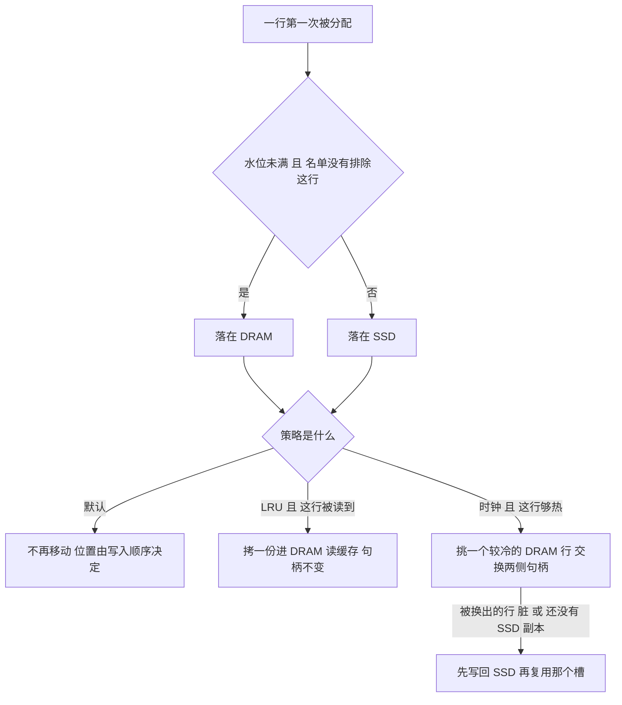
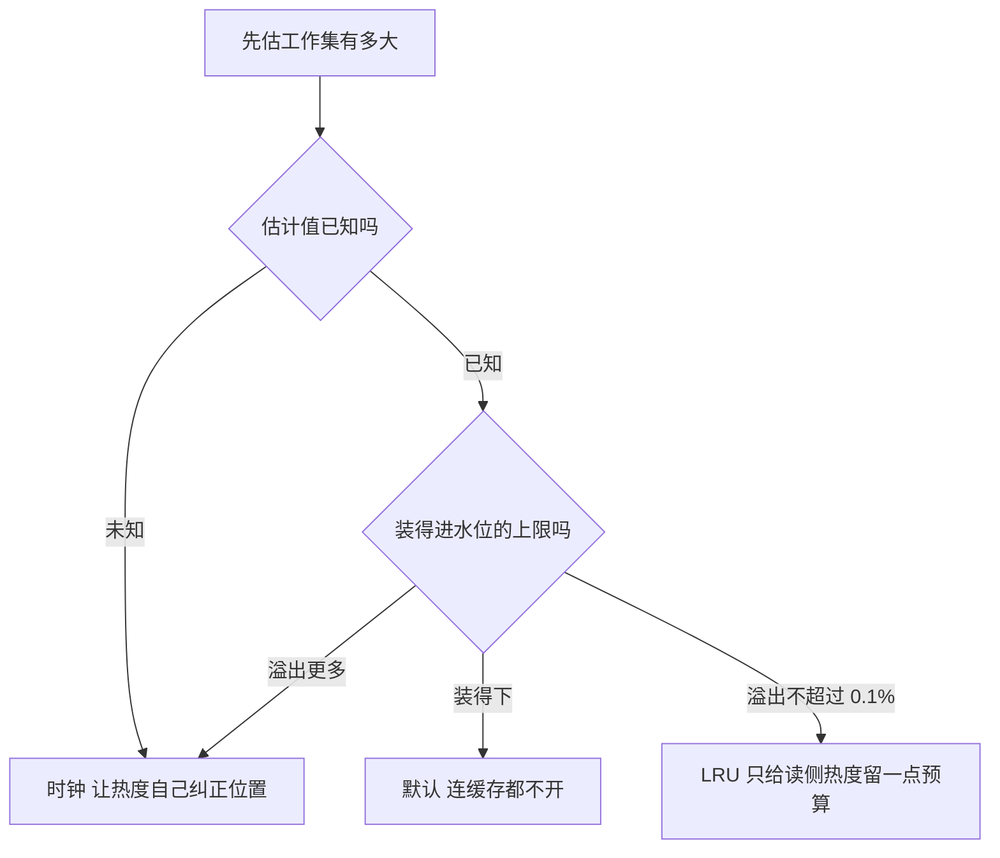

表比内存大，一行数据只能分两层放。默认策略下，哪一行留在内存只取决于它先被写进来，与读得多不多无关。这一页回答：一行怎么在两层之间移动、谁决定移动、四种策略各付什么代价。

## 它是什么

举例：内存 64 GiB、水位 0.85、每行 512 字节，能放进内存的约 1.1 亿行；而这张表有 3 亿行。也就是说大半的行注定在盘上，问题是哪一半。

分层策略只管三件事：新行第一次写入放哪、读过的盘上行要不要在内存另存一份、运行中要不要纠正已放好的位置。四种策略就是这三件事的不同组合。

读图：分配那一刻只有一道门——水位与初始名单决定这一行先落哪层；之后默认策略再不管它。LRU 只往内存加副本、句柄不动，所以读者拿到的仍是拷贝；时钟才会真换位置。全图只有两条箭头移动字节：交换把一行挪下盘、另一行挪上来，回写把还在内存里的字节先落盘；这两条是跨层动作，其余都是同层簿记。

策略键是 `value.tiering.cache_policy`，构造期只读一次，默认就是 none，也就是"不搬动"的那一档；非法值不会静默退化，直接抛 `std::invalid_argument`，服务起不来。选中时钟时整个值存储被换成另一套实现，接口签名不变。四种策略的代价可以摆在一起看：

| 策略 | 内存预算 | 会不会搬动已经放好的行 | 读的时候拿到什么 |
| --- | --- | --- | --- |
| `none` | 全长 `capacity`，按水位一次性安放 | 不会 | 内存行给池内视图 |
| `lru` | 先扣 `cache_budget_ratio` 一份读缓存预算，主安放上限降到 `high_watermark * (capacity - budget)` | 只把读过的 SSD 行提进缓存，句柄不变 | 缓存命中是拷贝 |
| `clock` | 共享 `high_watermark * capacity` 全长 | 按热度双向交换，脏行先回写 | 一律拷贝，不再有直接指针 |
| `adaptive` | 构造期按 `expected_dram_bytes` 估算工作集，在三者中选一个 | 同被选中的那个 | 同被选中的那个 |

LRU 的机制分两半：一半管结构与淘汰，一半管一致性与准入。

| 关心的事 | 做法 |
| --- | --- |
| 结构与淘汰 | 按盘上子层的句柄分片，每分片一把 `mutex`、一条 LRU 链、一个字节上限；命中在同一把锁下 `memcpy` 拷出，淘汰同一槽也要这把锁；分片满时先淘汰最旧再分配，单个值大于分片上限就放弃提升 |
| 生效上限 | 配置预算与"水位减去主安放"取较小者，再按分片均分 |
| 一致性与准入 | 读盘前取每 key 的令牌，提升前校验它仍是该 key 的当前值；`Write`、`BatchWrite`、`Free` 都换令牌，写穿透先换令牌再更新副本，值变短也不会露出旧尾巴；`Free` 时清掉准入计数；令牌与准入计数都是每分片 1024 项的直映射表，冲突只漏一次提升，不会留下陈旧副本 |

时钟把安放变成可纠正的：句柄是槽号加世代，交换期间不变；盘上的行攒够若干次成功读才尝试复用同分片里较冷的槽位，阈值是 `promote_min_misses`、默认 2，每次最多看 64 个候选，`try_lock` 抢不到的候选直接跳过、等下次访问再来。被选中的行要回写的先写盘——初始就放在内存或已被改过的都算——已有有效副本的直接复用，回写失败就保留原安放。三个开关改变选谁：

| 开关 | 默认 | 打开后 |
| --- | --- | --- |
| `retain_backing_copies` | `true` | 晋升后不释放盘上副本，之后淘汰不必重写；设成 `false` 时晋升即释放，只有 plain 布局允许，静态布局下构造直接抛错，而且以后每次淘汰都要再写一遍 |
| `clock_cost_aware` | `false` | 热度相同时优先淘汰已有有效副本、不必回写的行，不为省一次写而牺牲更热的数据 |
| `clock_frequency_admission` | `false` | 两层的访问频率按同一衰减周期比较，候选至少高出四分之一才交换；关着时只看内存侧的二次机会位与局部热度，开启后盘上的行也累计热度 |

交换要不要交给后台线程、队列能存多少，也是三个开关：

| 开关 | 默认 | 作用 |
| --- | --- | --- |
| `clock_async_exchange` | `false` | 关着时交换与回写在前台同步做完；打开后前台只入队，由后台线程执行 |
| `clock_exchange_queue_entries` | 256 | 队列的条目数上限 |
| `clock_exchange_queue_bytes` | 4 MiB | 队列的字节数上限 |

队列满、锁忙或句柄版本已变就放弃本次晋升，后续访问可重试，前台不会被卡住。缓冲区不计入驻留预算，但确实多占内存。

读保护也换了形态：读者先发布标记再检查 `readable` 可读位，写、释放、淘汰先撤可读位再等读者退出，所以热路径没有共享读锁。

批量读每 64 行发布一次快照，逐行读与 `BatchRead` 都按这个节奏拷贝。

代价是这一层不再给直接指针：`DirectPtr` 一律返回 `nullptr`，也不提供 RDMA 背后区域。

自适应只看一个输入：`expected_dram_bytes` 是完整工作集经分配器档位取整后的字节数，`0` 表示未知。装得下就不开缓存；溢出不超过估计工作集的 0.1% 就只加 LRU，把溢出折算成比例预扣；其余情况，包括未知，整套换时钟。

名单是另一条正交入口：`tiering.dram_keys_path` 指向一份排序去重、原生字节序的 `uint64` 数组，读进来就是初始内存名单，按历史热度先摆对位置。

- 只有带 key 的分配查名单：`AllocAndWrite(key, ...)` 与 `BatchAllocAndWrite(keys, ...)`。
- 不带 key 的 `Alloc` 不看名单，一律落盘。
- 与时钟互斥：`dram_keys_path` 和 clock 同时打开，构造直接报错。

## 它为什么存在

默认策略留下的内存行是"先写进来的"行，而训练里初始化写序与真实访问分布几乎不相关。LRU 只补读侧热度、不动初始安放；时钟连放错的行也换回来，代价是每次命中都要查元数据、拿到的还是拷贝。自适应存在的理由就是替你称一次重量：

读图：这张图只回答"自适应替你选哪一个"，它自己不动字节。分叉点只有估计值：未知就选时钟；已知再看装不装得下——装得下不付迁移成本，溢出一丝只加读缓存，溢得多才整套换安放。选完之后要做的簿记，就是上表和机制表里那些行。

在线准入由 `tiering.online_admission=true` 打开，让名单在运行期可改写，代价是一整套前置条件：

| 条件 | 不满足时 |
| --- | --- |
| `dram_keys_path` 非空，且策略不是时钟 | 值存储构造抛 `invalid_argument` |
| 盘上子层是 plain 布局，静态布局不支持 | 同上 |
| `default_value_size_hint` 非 0，且是 `sizeof(float)` 的整数倍 | 引擎构造抛错 |
| 优化器是 `SGD`，参数服务器是 `CachePS` | `CachePS` 构造抛错：在线交换只对定长 float 行的 SGD 成立 |
| `async_admission` 只在 `online_admission` 之上打开 | 引擎构造抛错 |

准入判据是二次未命中：某 key 第一次以冷行身份被读到只进影子集，影子集先进先出、容量取名单行数的二十分之一与 1 的较大者，第二次命中才把值拷成快照去换一个内存位。每批最多准入 256 行，上限按 `min(256, 16 × ceil(请求行数 / 500))` 计算，所以共享内存把多个 500 行窗口合成一次大请求时不会退化成 16 行。

交换是双向的：沿 `online_residents_` 游标找一个仍留在内存的受害者，受害者写盘、热点进内存，两侧新句柄都备好后一次发布。

发布走 `Index::BatchPutWithOld`，之后 `Retire` 旧句柄、让名单槽位指向新热点。

## 它和谁接

LRU 只挂在单条读与批量读上，其余入口的行为一张表能看完：

| 入口 | 在分层值存储上的行为 |
| --- | --- |
| `Read`、`BatchRead` | 命中缓存就给拷贝；`lru` 下没命中的盘上行可能被提升，`clock` 下每次命中都要查元数据 |
| `Write`、`BatchWrite` | 同步写穿透，先换令牌再更新副本 |
| `Free` | 该 key 在缓存里立即失效 |
| `DirectPtr` | 盘上句柄拿不到指针，返回 `nullptr` |
| `Get`、`BatchGetFlat`、`ApplySgdUpdateFlat`、检查点保存与加载 | 走同一套接口，`clock` 换实现不换签名 |
| `RDMABackingSize() == 0` | `clock` 下 RDMA 背后区域为 0，零拷贝读路径不可用 |

时钟换掉整个值存储，读、平铺读、优化器更新、检查点仍走同一套接口，变的是零拷贝那条路没了。在线准入的运行期约束收在另一张表里：

| 时刻 | 发生什么 |
| --- | --- |
| 任何前台写 | `Put`、`BatchPut`、`BatchDelete`、`ApplySgdUpdateFlat`、`BulkLoad`、检查点加载、`clear` 都先取 `online_mu_` 独占锁、自增 `generation`，正在准备的交换发现世代变了就整批放弃，计 `online_stale_jobs` |
| 同步交换 | 发布前逐个复核源句柄没被替换 |
| 异步交换 | 前台只拷值快照，后台准备私有目的槽再发布，失败时释放句柄并原样抛错 |
| 异步队列 | 只有一个待处理批次与一个工作线程，同 key 去重，满 256 行计 `online_queue_drops`；后台失败置停止位，下次前台调用重抛 |
| 静止点 | 保存与加载检查点（`SaveCheckpoint` / `LoadCheckpoint`）、`clear`、`ResetStats`、基准收尾都先排空后台（`DrainBackgroundWork()`） |

三种模式的统计都出现在 `ExtraResultFields()` 里，按前缀分三组：

| 前缀 | 覆盖什么 |
| --- | --- |
| `tiered_cache_*` | 预算、命中、淘汰、失败 |
| `tiered_clock_*` | 晋升、降级、回写、拒绝、交换队列的水位与峰值 |
| `online_*` | 晋升行数、交换批数、容量拒绝、提交与丢弃的作业、影子集体积 |

引擎在外层再加五组计时，形状是 `tier_{sgd_read,sgd_write,migration_read,migration_prepare,migration_publish}_{ns,max_ns,calls}`，分别覆盖优化器读、优化器写、迁移读、迁移准备、迁移发布。

统计取数前先排空后台：

- `CachePS::ExtraResultFields()`：先调 `DrainBackgroundWork()` 再取数。
- `LocalShmParameterServer::ExtraResultFields()`：也接上了这一步，但目前还没有调用方。

## 代码位置

要改代码时再看这里。

- `src/storage/value_store/hybrid_value_store.h#HybridValueStore::HybridValueStore` — 策略解析、参数校验、`adaptive` 选择、CLOCK 构造。
- `src/storage/cache/tiered_read_cache.h#TieredReadCache`、`#WriteBarrier`、`#Promote`、`#WriteThrough`、`#Invalidate`、`#EffectiveBudgetBytes` — `lru` 的结构、一致性与生效预算。
- `src/storage/value_store/tiered_clock_value_store.h#TieredClockValueStore`、`#TieredClockValueStore::Promote`、`#TieredClockValueStore::ReadFlatFixedRows` — CLOCK 的句柄、候选扫描、回写与按批读保护。
- `src/storage/value_store/hybrid_value_store.h#HybridValueStore::PrepareExchange`、`#HybridValueStore::ExchangeDramKeys`、`#HybridValueStore::KeyUsesDram` — `online_admission` 下的名单改写与准入判定。
- `src/storage/kv_engine/engine_composite.h#KVEngineComposite::MaybeAdmit`、`#KVEngineComposite::RunBackgroundJob`、`#KVEngineComposite::BackgroundLoop`、`#KVEngineComposite::DrainBackgroundWork` — ghost 准入、同步/异步交换、后台失败传播。
- `tools/benchmarks/build_tiered_dram_profile.py#build_profile` — 从历史稀疏窗口生成 `dram_keys.bin`（frequency / density，contiguous / fused）。

## 交付一句

分层策略到此为止：默认与 LRU 的位置由写入顺序决定，只有时钟会纠正，而纠正的代价是失去零拷贝读。[第 8 块](./ssd-nvm)接它下面的页与共享内存。
