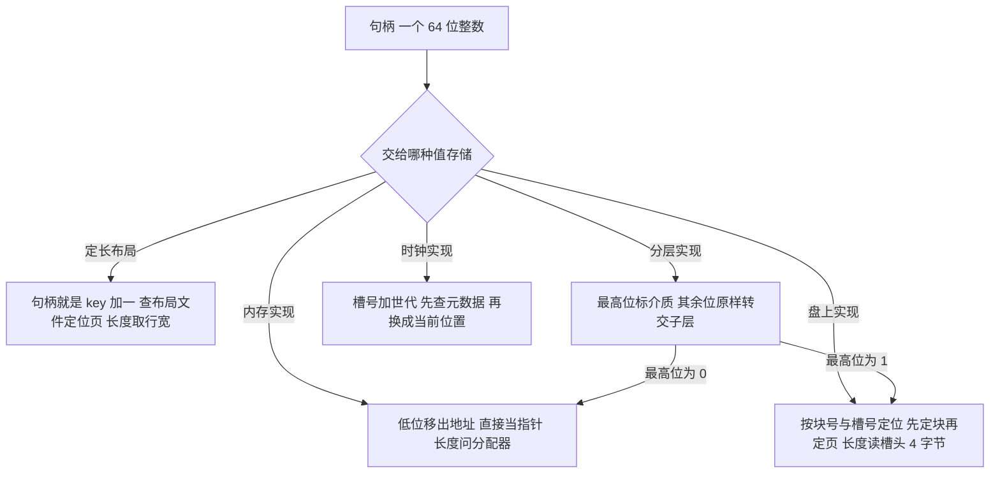

索引交出来的只是一个整数，叫句柄。真正那几百字节不归索引管，它在值存储里。这一页回答：同一个句柄在每种实现里怎么被解释成一段字节、长度由谁说了算、以及为什么其中一种实现拿不到裸指针。

## 它是什么

举例：默认表一行 512 字节，句柄只有 8 字节。一次读要做的，就是把这 8 个字节换算成那 512 个字节的地址，并且回答「这行实际有多长」——因为写入长度可以小于槽容量。

四种基础实现共用同一组动作：分配、写入、读取、取容量、释放。接口一样，差别只有三处：字节落在哪种介质、句柄怎么解释、长度从哪读。第五种不是新介质，而是时钟策略下换上来的整体替身。

读图：分叉只发生一次，先看交给谁。内存那条最短，句柄就是地址偏移，长度还要回头问分配器这个档位有多大；这条路径一步都不出进程，全是簿记。盘上那条才跨设备：先按块号定位、再按槽号定位，然后去块设备上读那一页，连长度头也躺在那页里。分层自己不解句柄，只把最高位撕下来判断介质，剩下的原样转交；时钟那条每次都要先查一张元数据表，所以它给不出裸指针。

| 实现（必填字段） | 句柄解释 | 长度来源 | 写语义 |
|------------------|----------|----------|--------|
| `DramValueStore`（`value.path`、`dram_allocator`） | 分配器 offset 编码 | `SlotCapacity`（分配器给的块大小） | 每次 `Alloc` 新槽 |
| `SsdValueStore`（`value.path`、`ssd_allocator` 含 `io`） | 块号 + 块内槽号 | slot 头 4 字节 | 整页读改写 |
| `SsdStaticLayoutValueStore`（`ssd_layout.mapping_path`、`default_value_size_hint`） | `key + 1`（`0` 表示缺失） | artifact 的 `row_size` | 只改已有页槽 |
| `HybridValueStore`（`dram_allocator` + `ssd_allocator`） | 最高位标记介质，低 63 位是子层句柄 | 转交子层 | 按 `Alloc` 时的介质决定 |
| `TieredClockValueStore`（由 `HybridValueStore` 在 `cache_policy=clock` 时构造） | 元数据槽号 + 世代，交换期间不变 | 元数据里的 `size` | 命中 DRAM 原地写，SSD 行改后回写 |

分层实现的介质不是在读的时候才决定的，而是分配那一刻当场定下、之后不再搬动。判据是一次水位比较：

| 关心的点 | 规则 |
|----------|------|
| 什么时候定介质 | `Alloc` 时一次定下，写、读都不再改判 |
| 怎么判 | 拿已占字节加上这次要的大小，与「内存容量乘水位」比，没超就放内存；算子写作 `(dram_bytes_reserved_ + size) / dram_placement_bytes_` 不超过 `high_watermark_ratio` |
| 水位默认多少 | 0.85，也就是容量用到八成半就开始往盘上放 |
| 上限被谁改小 | 打开读缓存先扣一份预算，扣完剩下的才当上限；所以 `dram_placement_bytes_` 平时等于 `capacity_bytes`，开了缓存就变小 |
| 盘上句柄怎么打标 | 最高位置 1 当标记，低 63 位原样保存子层句柄，标记常量是 `kSsdFlag = 1 << 63` |
| 打标之后谁受影响 | `DirectPtr` 遇到盘上句柄一律返回 `nullptr`，即使该值正被读缓存持有 |
| 盘上句柄具体长什么样 | 默认的盘上分配器按档位切槽：高 16 位是档位下标，低 48 位是块内槽号加一，所以「块号 + 块内槽号」这句话只对默认分配器成立 |

配置名是 `TIERED_VALUE_STORE`。它和另外三种基础实现的区别到此为止：接口仍是同一套，句柄仍是那 8 个字节，只是多了最高位这个约定。

时钟模式换的是解释句柄的整套规则。配置里写 `cache_policy=clock` 时，分层实现不再按最高位分流，把全部调用交给 `TieredClockValueStore`。

后者自己同时持有内存槽与盘上行，逻辑句柄是「槽号 + 世代」：冷热交换只换内容、不换句柄，所以握着句柄的调用方不必改。代价是每次读都要先查一次元数据表，也因此不再提供直接指针与 RDMA 背后区域，读一律走复制路径。

## 它为什么存在

介质是配置项，不是代码分支。四种实现共用同一组动作之后，上层不必知道自己连的是内存还是块设备；分层再往前走一步，把两种介质放进同一份配置里。

默认策略与读缓存模式下，一行落在哪层只看它先被写进来时水位够不够，定了就不再动。这两条路的名字分别是 `none` 与 `lru`。

只有时钟把"放错介质"变成可在线纠正的事：按访问热度交换，代价是每次读都要过元数据而不是裸指针。

## 它和谁接

向上被引擎的读、写、检查点三条路径调用。向下要求分配器提供四类能力：分配、释放、取大小、取底层连续区域。

RDMA 背后区域只透出内存子层：`RDMABackingData()` 只覆盖 DRAM 子层，盘上子层没有背后区域，时钟模式下 `RDMABackingSize()` 直接返回 0。

平铺快路还有一个前置条件，要求布局是平的，也就是 `GetLayoutId().plain()` 为真，见第 5 块。

时钟实现自己写了 `ReadFlatFixedRows` 与 `BatchRead`，所以平铺读在时钟模式下仍然可用，只是要按行拷贝。

## 代码位置

要改代码时再看这里。

- `src/storage/value_store/value_store.h#ValueStore` — `Alloc`/`Write`/`Read`/`Retire`/`DirectPtr` 的公共形状。
- `src/storage/value_store/dram_value_store.h#DramValueStore::Read`、`#DramValueStore::SlotCapacity` — 槽容量即返回长度。
- `src/storage/value_store/ssd_value_store.h#SsdValueStore`、`src/storage/value_store/ssd_static_layout_value_store.h#SsdStaticLayoutValueStore` — 块号+槽号与长度头、定长布局与页锁。
- `src/storage/value_store/hybrid_value_store.h#HybridValueStore::Alloc`、`#HybridValueStore::ShouldUseDram`、`#HybridValueStore::kSsdFlag` — 介质选择与 handle 最高位。
- `src/storage/value_store/tiered_clock_value_store.h#TieredClockValueStore`、`#TieredClockValueStore::Promote`、`#TieredClockValueStore::FreeLocked` — CLOCK 模式下的句柄、晋升与槽回收。

## 交付一句

第 3 块到此为止，读者应当知道句柄怎么解释、长度谁说了算、tiered 在哪一步定下介质，以及 `clock` 为什么会换掉整个值存储。[第 4 块](./allocator)接这些字节的来源。
