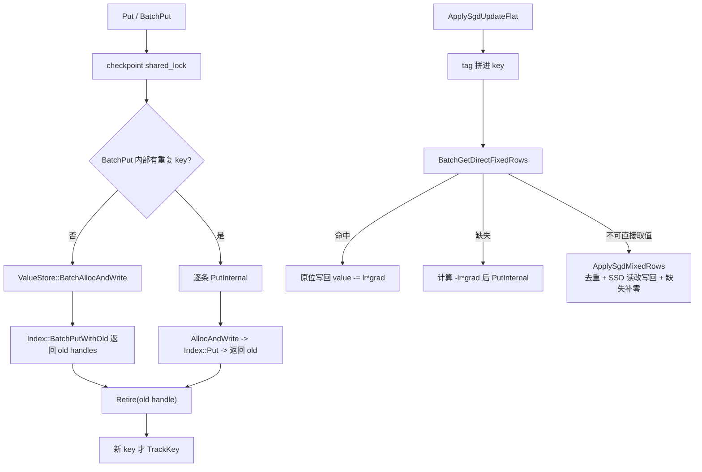

## 它是什么

写入不是原地覆盖。普通写先向值存储要一个新槽，写入字节，再让索引把 key 指向新句柄，最后把旧句柄交出去。这条顺序的含义是：任何已读到旧句柄的读者，在旧槽被回收前都能读到一致的旧值。

五种写法的差别：`Put` 走 `AllocAndWrite` → `Index::Put` 返回旧 handle → 旧 handle `Retire` → 新 key 才 `TrackKey`；`BatchPut` 先扫重复 key，有重复就逐条 `PutInternal`（避免同批顺序不确定），无重复则 `BatchAllocAndWrite` + `Index::BatchPutWithOld` 一次性替换，再统一 `Retire`；`BulkLoad` 要求 `default_value_size_hint` 非 0，按固定步长切分传入 buffer，批量分配后 `Index::BatchPut`；`BatchDelete` 在独占锁下 `Index::Get` → `Index::Delete` → `Retire`，并从每线程检查点 key 列表里删除。

`online_admission` 打开时写入还多两道手续：先拿 `online_mu_` 独占锁（锁序是 `online_mu_` → `checkpoint_mu_`），再自增 `online_generation_`，让正在准备的交换整批失效。`BatchPut` 顺带改了校验顺序：先逐行校验行宽并收集全部重复 key，检查完才决定"逐条 `PutInternal`"还是批量替换，不再遇到第一个重复就 `break` 掉后面的校验。

`ApplySgdUpdateFlat` 是唯一的原地更新：把 `tag` 放到 key 高 8 位（`(tag << 56) | (key & 0x00FF_FFFF_FFFF_FFFF)`），先试 `BatchGetDirectFixedRows` 拿原位指针，命中行直接在池内 `value[c] -= lr * grad[c]`；未命中行按 `-lr * grad` 生成初值再 `PutInternal`。命中路径不走写时复制。

拿不到原位指针时（非 plain 布局、SSD 行、CLOCK 句柄）走 `ApplySgdMixedRows`：先按 key 去重并记录每个输入行的目标位置，重复 key 按输入顺序累加；DRAM 命中行仍是原地更新，SSD 行经 `BatchRead` 拷出、改完再用 `BatchWrite` 写回，最后给缺失 key 写零初值。拷贝出来的行不会被就地当成存储，所以写回之前后续读看不到这步更新。

## 它为什么存在

写时复制让读路径可以不阻塞：读者拿到的指针只指向一个不会再被改写内容的槽。优化器更新是例外，它把梯度直接减到池内，省掉一次分配和一次拷贝，代价是绕开写时复制带来的隔离。

## 它和谁接

向上承接参数服务器的写入与优化器更新，向下调用值存储的分配与释放、索引的替换与删除。写路径持共享检查点锁，因此与检查点互斥；它不阻止读。tiered 的写路径按策略维护分层：`lru` 同步写穿透缓存、`clock` 命中 DRAM 时原地写、落到 SSD 的行写后标记为脏以便后续回写（见第 7 块）。

退役与迁移：`Retire` 是唯一的回收入口——`DramValueStore` 用 `ThreadSafeDelayedRecycle`（`kRecycleDelayUs = 1000`，每线程一份延迟队列）；`ValueStore` 基类默认 `Retire → Free`；`SsdStaticLayoutValueStore::Free` 是空实现；`SsdSlabAllocator::Free` 只归还槽位，块在 `used_count == 0` 时变成块级 tombstone 并回到全局空闲块表。tiered 在 `none` / `lru` 下没有覆写 `Retire`，SSD 旧槽立即释放、DRAM 旧槽立即 `Free`；CLOCK 覆写为把槽位放进分片 `free_slots`，下次复用前把世代加一（世代替换到 `UINT32_MAX` 后该槽不再复用，防 ABA）。主放置是否迁移取决于策略：`none` / `lru` 只在 `Alloc` 时按水位决定介质，块写满就永远留在原介质；`clock` 按访问热度在线交换，见第 7 块。`src/storage/cache/` 里那套 `CachePolicy` / `LRUCachePolicy` 仍只被 `test_storage_cache_lru` 使用，`lru` 读缓存没有建在它上面。

检查点：保存时遍历每线程的检查点 key 列表，排序去重后逐 key 读值，写固定 magic、版本 3、metadata、布局标识、记录与校验和，最后用重命名发布。加载要求引擎为空、metadata 完全一致、布局标识一致（v2 文件只允许恢复到 plain 引擎），否则拒绝。整条路径在独占锁下运行，会阻塞所有写。

## 代码位置

- `src/storage/kv_engine/engine_composite.h#KVEngineComposite::PutInternal` — 分配、替换、退役的顺序。
- `src/storage/kv_engine/engine_composite.h#KVEngineComposite::BatchPut` — 重复 key 退化逐条。
- `src/storage/kv_engine/engine_composite.h#KVEngineComposite::ApplySgdUpdateFlat` — tag 拼 key 与原地更新。
- `src/storage/kv_engine/engine_composite.h#KVEngineComposite::SaveCheckpoint`、`#KVEngineComposite::LoadCheckpoint` — 检查点格式与空引擎约束。
- `src/storage/value_store/value_store.h#ValueStore::Retire`、`src/storage/value_store/hybrid_value_store.h#HybridValueStore` — 默认退役与分层丢弃延迟回收。
- `src/storage/cache/cache_factory.h#CreateCachePolicy` — 只被测试使用的策略工厂。

## 交付一句

第 6 块到此为止，读者应当知道"写是换槽、退役是唯一回收、`none` / `lru` 的主放置不迁移"。[第 7 块](./tiering)接 tiered 的四种分层策略。
