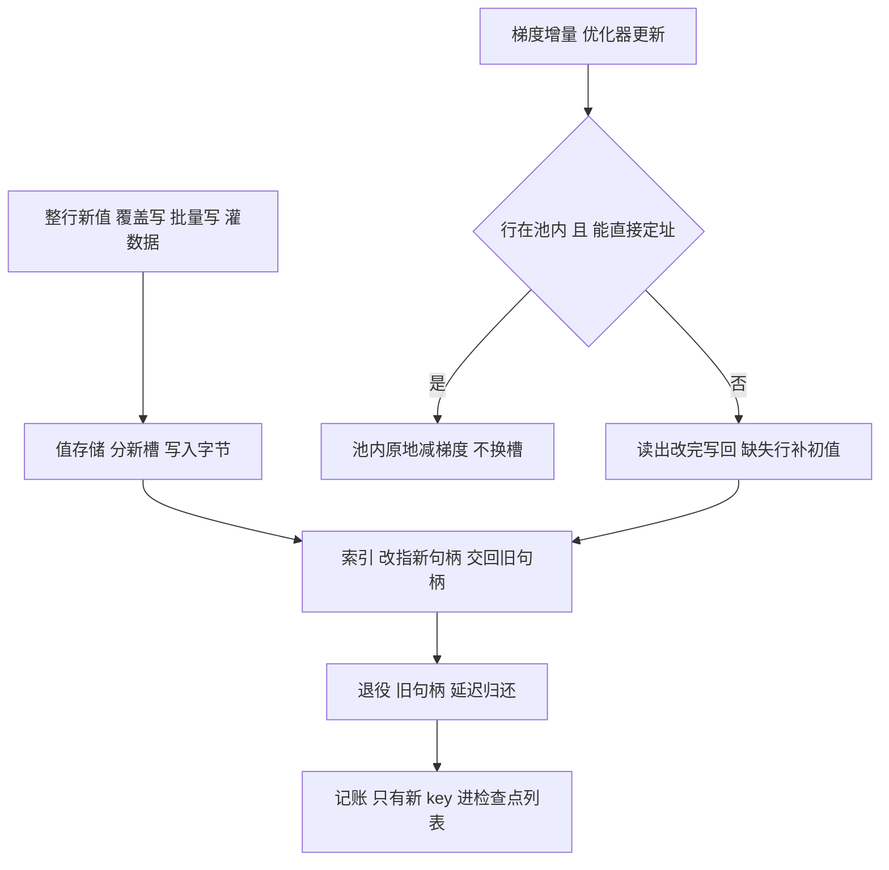

写入看着像"改一行"，在存储层却通常是一次换槽：新字节写在新地方，索引换一根指针，旧地方排队等回收。这一页回答两件事——一次写有几种落法、每种各经过哪几层；以及为什么这条路径宁可多分配一次，也不肯让读等它。

## 它是什么

举例：一次稀疏更新送进存储层 8000 个 key、每行 128 维，约 4 MB。如果每行都换新槽，这一次就要分配 4 MB、退役 4 MB；而优化器每步都来这么一次，所以另有一条原地改的路。

先看覆盖写。它经过四步，顺序不能换：

1. 向值存储要一个新槽，把字节写进去。
2. 索引改成指向新句柄，同时把旧句柄交回来。
3. 旧句柄交给退役，进入延迟回收队列。
4. 只有原本不存在的 key 才登记进检查点列表。

旧槽从第 2 步起就没人再写了，所以握着旧句柄的读者还能读到一份一致的旧值；这就是写时复制换来的读不阻塞。

再看优化器更新。它走另一条路：

1. 把 8 位 tag 拼进 key 的高位，同一行在不同标签下算不同的 key。
2. 整批试探能不能拿到池内原地指针。
3. 能拿到，就在池内按列减梯度，不分配、不换槽。
4. 拿不到（盘上行、静态布局、开了在线准入），就退到混合路径：读出来、改完、写回。

读图：上路是换槽，四层依次过——分槽写字节、索引改指、退役旧句柄、给新 key 记账；新字节从不覆盖旧槽，所以握着旧句柄的读者还能读到一致的旧值。下路是优化器更新，能直接定址就只碰值存储这一层；落在 SSD 或布局不能定址时，才读出、改完写回，并重新走上路的改指与退役。全图只有这一格真的把字节搬过介质，其余都是内存里的动作——删除不在图里，它只做摘索引与退役两步，且整段在独占锁下。

把落法按层数摆开，差别只有两处：要不要换槽，换完要不要改索引：

| 落法 | 经过哪几层 |
| --- | --- |
| 覆盖写 | 分新槽写字节、索引改指、退役旧槽，只有新 key 才记账 |
| 批量写 无重复 | 一次批量分槽，一次批量替换并交回旧句柄，再统一退役 |
| 批量写 有重复 | 同批重复 key 以最后一次赋值为准，仍然一次批量分配、一次批量替换 |
| 灌数据 | 要求默认行大小非 0，按固定步长切开传入缓冲，批量分槽后批量建索引 |
| 优化器更新 | 能直接定址就在池内减；不能就读出改完写回，缺失行补初值 |
| 删除 | 独占锁下摘索引、退役，再从每线程的检查点列表里删掉 |

批量写还改了一处校验顺序：先把每一行的行宽都校验完、把重复 key 收齐，再决定走逐条还是批量；不会撞上第一个重复就中断，把后面的行跳过去不校验。

优化器这条路要单独说：命中路径直接在池内做减法，不走写时复制；同一行在不同 tag 下算不同 key，所以表号不需要在存储层再存一份。

拿不到原位指针时改走混合路径：先按 key 去重并记下每个输入行的目标位置，重复 key 按输入顺序累加；内存行照旧原位改，只有盘上的行要读出来改完写回，最后给缺失的 key 补上初值。拷贝出来的行不算存储，写回之前后续读看不到这次更新。

打开在线准入后，写入还要多两道手续：先拿在线锁再拿检查点锁，然后自增在线世代，让正在准备的交换整批失效。

## 它为什么存在

写时复制换来读不阻塞：读者手里的指针只指向一个不会再被改写的槽。代价是每次覆盖都要分配、拷贝、退役，所以优化器那条路绕开它，把梯度直接减到池内，省掉一次分配和一次拷贝，代价是这步更新对并发读者没有隔离。

退役是唯一的回收入口，而各层归还的方式并不一样：

| 值存储 | 退役时做什么 |
| --- | --- |
| DRAM 并发池 | 每线程一份延迟队列，先压 1000 微秒再归还 |
| 基类默认 | 直接释放 |
| SSD 静态布局 | 空实现，什么都不做 |
| SSD 分槽 | 只归还槽位，块内用完才变成块级墓碑回到全局空闲块表 |
| 分层 CLOCK | 槽位进分片空闲表，复用前世代加一，加到顶就不再复用，防 ABA |

分层策略还会改写写的语义：LRU 下同步写穿透，写入同时更新缓存副本；CLOCK 命中 DRAM 时原地写，落到 SSD 的行写后被标脏，等后续回写。默认与 LRU 都不覆写退役，SSD 旧槽立刻释放、DRAM 旧槽立刻归还。

## 它和谁接

向上承接参数服务器的写入与优化器更新，向下调用值存储的分配与释放、索引的替换与删除。写路径持共享检查点锁，因此与检查点互斥，但不阻止读。

主放置是否迁移取决于策略：默认与 LRU 只在分配时按水位定介质，块写满就永远留在原介质；只有时钟会在线交换。缓存工厂那套通用策略不参与这条路径，只被一个存储层测试使用。

检查点在独占锁下运行，会阻塞所有写：保存时遍历每线程的 key 列表，排序去重后逐 key 读值，写 magic、版本 3、metadata、布局标识、记录与校验和，最后重命名发布；加载要求引擎为空、metadata 与布局标识一致，旧版本文件只允许恢复到 plain 引擎。

## 代码位置

要改代码时再看这里。

### 五种落法各经过哪几层

| 落法 | 顺序与判据 |
| --- | --- |
| 覆盖写 | `AllocAndWrite` 向值存储要新槽并写字节，`Index::Put` 换指并交回旧句柄，旧句柄 `Retire`；只有旧句柄为空的新 key 才 `TrackKey` |
| 批量写 无重复 | `BatchAllocAndWrite` 一次分完所有槽，`Index::BatchPutWithOld` 一次替换并交回旧句柄数组，再统一 `Retire` |
| 批量写 有重复 | 同批按 key 去重，最后一次赋值胜出，仍然通过批量分配与替换发布 |
| 灌数据 | `BulkLoad` 要求 `default_value_size_hint` 非 0，按固定步长切开传入缓冲，批量分配后 `Index::BatchPut` |
| 删除 | `BatchDelete` 在独占锁下 `Index::Get` 取旧句柄、`Index::Delete` 摘索引、`Retire` 归还，再从每线程检查点列表里删掉 |

`BatchPut` 的校验顺序和这张表绑定：先逐行校验行宽、收齐全部重复 key，检查完才决定走逐条还是批量。旧写法一遇到重复就 `break`，后面的行根本没校验过。

### 优化器更新

- 拼 key：`(tag << 56) | (key & 0x00FF_FFFF_FFFF_FFFF)` 把 8 位标签放进高 8 位，于是同一行在不同标签下算不同的 key。
- 拿原位指针：`BatchGetDirectFixedRows` 整批试探，成功才有一块可原地写的视图。
- 命中：池内按列减 `value[c] -= lr * grad[c]`，不分配、不换槽，也不走写时复制。
- 缺失：以 `-lr * grad` 当初值，走 `PutInternal` 建行。
- 冷行：`BatchRead` 把盘上的行拷出来，改完 `BatchWrite` 写回；拷贝不算存储，写回之前后续读看不到这次更新。
- 退路：整批拿不到原位指针时改走 `ApplySgdMixedRows`，先按 key 去重并记下每个输入行的目标位置，重复 key 按输入顺序累加。

### 锁序与在线世代

| 步骤 | 做法 |
| --- | --- |
| 开关 | `online_admission` 打开才走下面两步 |
| 锁序 | 先 `online_mu_` 独占，再 `checkpoint_mu_`；所有写入口都按这个顺序，反了会让两条写路径互相等锁 |
| 失效 | 自增 `online_generation_`，正在准备的交换发现世代不符就整批作废 |

### 退役与分层

| 层 | 退役时做什么 |
| --- | --- |
| `DramValueStore` | `ThreadSafeDelayedRecycle`，`kRecycleDelayUs = 1000`：每线程一份延迟队列，先压 1000 微秒再归还 |
| 基类默认 | `Retire → Free`，直接释放 |
| `SsdStaticLayoutValueStore::Free` | 空实现，什么都不做 |
| `SsdSlabAllocator::Free` | 只归还槽位；块在 `used_count == 0` 时变成块级墓碑，回到全局空闲块表 |
| 分层 CLOCK | 槽位进分片 `free_slots`，复用前世代加一；加到 `UINT32_MAX` 后该槽不再复用，防 ABA |

- 策略名：`none`、`lru`、`clock`。前两个不覆写 `Retire`，SSD 旧槽立即释放、DRAM 旧槽立即 `Free`；只有 `clock` 覆写。
- 主放置：`none` / `lru` 只在 `Alloc` 时按水位决定介质，块写满就留在原介质；`clock` 才在线交换。
- 缓存工厂：`LRUCachePolicy` 只被 `test_storage_cache_lru` 使用，`lru` 读缓存没有建在它上面。

入口文件：

- `src/storage/kv_engine/engine_composite.h#KVEngineComposite::PutInternal` — 分配、替换、退役的顺序。
- `src/storage/kv_engine/engine_composite.h#KVEngineComposite::BatchPut` — 重复 key 去重与批量替换。
- `src/storage/kv_engine/engine_composite.h#KVEngineComposite::ApplySgdUpdateFlat` — tag 拼 key 与原地更新。
- `src/storage/kv_engine/engine_composite.h#KVEngineComposite::SaveCheckpoint`、`#KVEngineComposite::LoadCheckpoint` — 检查点格式与空引擎约束。
- `src/storage/value_store/value_store.h#ValueStore::Retire`、`src/storage/value_store/hybrid_value_store.h#HybridValueStore` — 默认退役与分层丢弃延迟回收。
- `src/storage/cache/cache_factory.h#CreateCachePolicy` — 只被测试使用的策略工厂。

## 交付一句

写路径到此为止：写是换槽、退役是唯一回收、默认与 LRU 的主放置不迁移。[第 7 块](./tiering)接四种分层策略，回答这一行为什么会从内存挪到盘上、又怎么被挪回来。
