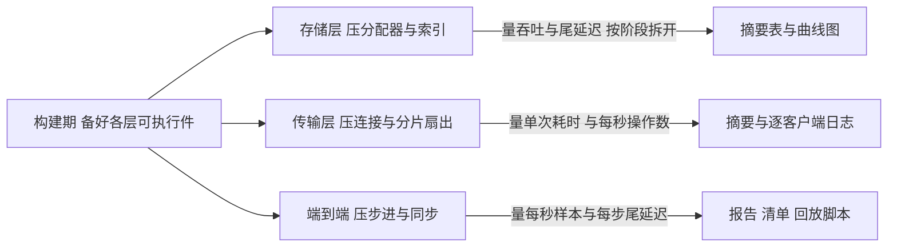
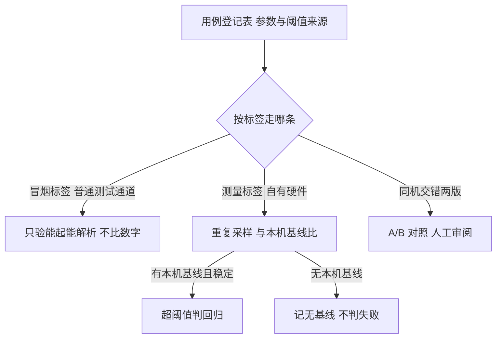

这一页回答两个问题：手上这个问题该用哪一层基准去量，以及量出来的数字能不能进基线。它是一张地图，不是教程——先按被测对象定位到层，再看那层的驱动、口径和产物。

## 它是什么

举例：把内存分配器换成另一套，三层的数字都会动，但各自说明的事不同。存储层看到的是同一批 key 的尾延迟，传输层看到的是每秒操作数，端到端层看到的是每个 step 多花了多少毫秒。把三层的数字混在一起看，就会把「某一层退化」误读成「整体变慢」。

三层各自压什么、量什么、留下什么产物？



最左边那个节点是构建时成本：各层可执行件都备好之后，下面那三条箭头才是运行时。每条箭头上的文字写明这层压什么、量什么，右边是产物。三层没有共享的指标名，所以跨层比大小没有意义，只有同层同机器前后比才有意义。

## 它为什么存在

[推断] 三层的失效原因不同：存储层在分配器与索引，网络层在传输与分片，端到端层可能在步进同步。混层比较会得到"改了 A 却让 B 变慢"的错误结论，所以报告必须写明层号。

另一条理由更实际：数字要能拦住回归，就得有基线和阈值。自 `aea93f8b` 起，注册式套件把其中可回归的用例抽出来，变成有基线的门禁；跑不动的用例留在原处，手工执行。

## 它和谁接

向上被验证路径引用，向下调用 C++ 基准二进制与训练脚本。端到端那层还会拉起参数服务器，所以它同时依赖 03–05 章的部署前提。想把这个数字变成门禁，则要经过注册式套件这一关。

一个数字从跑出来到变成门禁，中间要过哪几道判断？



上面那个菱形是入口：冒烟标签走普通测试通道，构建完就能跑，几分钟内给一个「没坏」；测量标签只在自有硬件上跑，才有基线和阈值；同机交错两版走 A/B 对照，差异由人审阅。这一层没有构建期成本，改登记表不用重新编译。要注意的是基线按机器分目录，换机器不继承——所以「无基线」是一种状态，不是失败。

## 代码位置

要改代码时再看这里。三层各自的驱动、被测二进制、指标与产物先列成一张表，然后是决定口径的两个子块，最后是按文件列的入口。

### 三层的驱动与产物

| 层 | 驱动 | 被测二进制 | 主要指标 | 产物 |
| --- | --- | --- | --- | --- |
| storage-only | `run_kvengine_compare.py` | `benchmark_kv_engine` | 吞吐、p50/p90/p99/max、BatchGetFlat 阶段 | `summary.csv`、`kvengine_*_summary.csv`、`*.svg`、`logs/`、`data/` |
| ps_transport | `run_benchmark_ps.py` | `ps_transport_benchmark` | `elapsed_us_*`、`ops_per_sec`、`key_ops_per_sec`（load/measure 两阶段） | `summary.csv`、`summary.md`、`run_config.json`、每 client 日志 |
| e2e | `e2e/custom/cli.py`（或 `bench_compare.py`） | `run_mock_stress.py` + PS | `samples_per_sec`、`p95_step_total_ms`、`lookup/update_mrows_per_sec`、13 项阶段均值 | `summary.md`、`summary_e2e.csv`、`manifest.csv`、`deployment.md`、`commands.sh`、`outputs/` |

### 子块 4.1：注册式性能套件

用例登记表 `tools/benchmarks/perf/cases.json` 是唯一的参数、指标与噪声阈值来源，执行器只负责按表跑。两个标签分工明确：

| 标签 | 跑在哪 | 目的 |
| --- | --- | --- |
| `perf_smoke` | 普通 ctest lane，含 GitHub CI | 极小规模金丝雀：二进制能起、指标能解析；不比数字 |
| `perf` | 自有硬件（node190/191） | 带 `repeats` 与基线比较的真实测量；CI 用 `-LE "^perf$"` 排除 |

冒烟用例已经作为普通测试项登记，共用一把资源锁、串行跑；测量用例不登记，只能显式调用。

- 已登记的三条冒烟项：`perf_smoke_kvengine_c_read`、`perf_smoke_kvengine_a_mixed`、`perf_smoke_ps_local_shm_fetch`，共用 `RESOURCE_LOCK perf_smoke`。
- 测量用例目前 4 个：`kvengine_c_read_full`、`kvengine_a_mixed_full`、`kvengine_tiered_scramble`、`ps_local_shm_fetch_full`；`layer` 字段允许 `e2e`，但暂无 e2e 用例。

命令以 `tools/benchmarks/perf/README.md` 为准：

```bash
# CI 金丝雀（CPU，约 5 s）
python3 tools/benchmarks/perf_suite.py run --label perf_smoke
# 自有硬件：重复采样并与基线比较
python3 tools/benchmarks/perf_suite.py run --label perf --repeats 3 --check
# 显式录基线（diff 需人工审阅）
python3 tools/benchmarks/perf_suite.py run --label perf --repeats 3 --write-baseline
# 同一机器上交错 A/B 两个 build 或两组参数
python3 tools/benchmarks/perf_suite.py ab --case kvengine_c_read_full --a-build /tmp/base-build --b-build ./build --check
```

基线按机器分目录，目录名默认由主机名与 CPU 型号拼成，仓库里已提交的参考桶是 `node190-intel-r-xeon-r-gold-5420`。**不能跨机器比**，其余判定规则如下：

- 路径形状：`baselines/<env-id>/<case-id>.json`，`env-id` 默认 `<hostname>-<cpu-model>`。
- `--check` 对没有桶的机器报 `no-baseline` 而不是失败。
- CPU 频率与基线差超过 15% 时报 `env-mismatch`。
- 同一次运行内 repeats 超过噪声阈值时报 `unstable`，且不设门禁。
- 退出码：0 正常、1 执行错误、2 超出噪声阈值的回归。
- 产物在 `results/perf_<MMDDHHMM>/`：`metrics.json`、`summary.md`、`env.json`、`logs/`、`work/`。

### 子块 4.2：驱动脚本与默认值

每个驱动都有自己的默认值，跑之前先看默认值比逐个看参数省事。

- `run_benchmark_ps.py`：默认 `--transports rdma,grpc,brpc`、`--index-type DRAM_EXTENDIBLE_HASH`、`--dram-allocator PERSIST_LOOP_SLAB`、`--value-store-type DRAM_VALUE_STORE`；生成的配置把 `value.tiering.cache_policy` 设为 `none`。拓扑来自 `--server-shard-ips`/`--server-plan` 与 `--client-ips`/`--client-plan`，`--execution-backend` 取 `local` 或 `ssh`。
- `run_kvengine_compare.py`：默认 engines 为 `petkv dram_pet_dram dram_pet_tiered`，`--dram-allocator CONCURRENT_SLAB_MEMORY_POOL`；`--read-mode {exists,get,batch_get_flat}`、`--engines`、`--workloads`、`--threads`；`--draw` 只重绘 `summary.csv`。
- `benchmark_kv_engine` 的 tiering 旋钮分两组：`--tiering_cache_policy` / `--tiering_cache_budget_ratio` / `--tiering_promote_min_misses` 有 `--tiered_cache_*` 别名，同参数两种名字给了不同值会直接报错；CLOCK 另有 `--tiered_clock_{frequency_admission,cost_aware,async_exchange,exchange_queue_entries,exchange_queue_bytes}` 与 `--tiered_retain_backing_copies`、`--tiered_cache_expected_dram_bytes`。
- 名单与在线准入走另一组：`--tiered_dram_keys_path`、`--tiered_online_admission`（同时把 `high_watermark_ratio` 提到 0.90）、`--tiered_async_admission`（要求前一个），装载侧可用 `--load_batch_keys` 改走 `BatchPut`。
- 访问序列可以完全脱离随机分布：`--distribution=trace --access_trace=<binary uint64>` 回放真实 key 流，`--warmup_access_trace` 单独给预热窗口，`--load_order` 按历史热度决定初始装载顺序。
- `--read_trace_path=<文本 query log>` 是同一位置的另一种输入（经 `ssd_layout::ReadQueryLog` 转成 pin 序列，记录数必须等于 `--record_count`），与 `--access_trace` 互斥。结果行新增 `process_peak_rss_kb`；正式计时前 `ResetStats()`，收尾 `DrainBackgroundWork()`，预热/计时窗口与 `YCSB_RUN_MAINTENANCE` 一起决定"异步交换是否已排空"。
- `build_tiered_dram_profile.py`：从历史稀疏窗口生成 `--tiered_dram_keys_path` 要的 `dram_keys.bin` + `profile.json`（`--strategy {frequency,density}`、`--key-encoding {contiguous,fused}`、`--profile-end`、`--dram-rows`），输出目录必须不存在；评估窗口不参与选择。
- `recstore.telemetry`：ctypes 加载 `libreport.so` 调 `report()`，让 Python 样本与 C++ 调用点进同一批 sink；导出 `available` / `emit` / `library_path` / `report_metric` / `reset`，库缺失时 `available()` 为 `False`、`emit()` 返回 `False` 而不抛，`RECSTORE_REPORT_LIBRARY` 覆盖库路径且候选按 mtime 取新。`rs_demo --report-metrics` 用它把 `_E2E_STEP_METRICS` 的 13 列以 `e2e_step` 表发出（仅 rank 0），连续循环的 loss 在末尾读回后补发。
- `run_tiered_cache_sweep.py`：按 `--policies {none,lru,clock,adaptive}`、`--cache-budget-ratios`、`--ssd-ratios`、`--record-count`、`--dram-slot-bytes`（必填）扫缓存预算与 SSD 比例，产物是 `summary.csv` + `summary.md`；`--disable-fit-check` 把 `expected_dram_bytes` 置 0，比较"已知工作集"与"未知工作集"两种策略选择。
- `e2e/custom/cli.py`：默认 `--transports brpc`、`--index-type DRAM_PET_HASH`；`runtime.py` 把 `--ps-kv-backend` 写死为 `recstore_dram`，所以这条 e2e 链路没有 tiering 段。tiered 的端到端数字走 `model_zoo/rs_demo` 自身入口（`--ps-kv-backend recstore_tiered --tiered-cache-policy {LRU,none,clock}`，默认 `clock`），`docs/performance/tiered-e2e.md` 的基线就是这条路径且显式标为 cache-off。
- `run_ps_dram_transport_benchmark.py`：临时起 PS 测本地 DRAM transport，同样写入 `tiering.cache_policy=none`。
- lane 驱动：`run_all.py` / `run_main_results.py` / `run_stage_breakdown.py` / `run_recstore_chain.py` 共用 `tools/benchmarks/lanes.py#build_suites`，lane 固定 `steps=12`、`warmup=2`（`common.py`）。
- 拓扑：本地用 `127.0.0.1` 起单 client / 单 shard；跨机用 `--client-plan`/`--server-plan` 指定 host，`--execution-backend ssh` 远程拉起。完整驱动与产物清单见章末基准附录。

### 按文件查

- `src/benchmark/ps/ps_transport_benchmark.cc#PrintTransactionResult` — `transport=/op=/phase=/summary ...` 行格式。
- `src/storage/kv_engine/benchmark_kv_engine.cc` — workload / read mode / latency / trace 输入 / 名单与在线准入开关。
- `tools/benchmarks/build_tiered_dram_profile.py#build_profile` — 历史窗口 → `dram_keys.bin` 与 `profile.json`，`src/test/scripts/test_build_tiered_dram_profile.py` 覆盖排序、density 估计、fused 编码与非法参数。
- `tools/benchmarks/perf_suite.py`、`#perf/cases.json`、`#perf/README.md` — 用例注册表与执行器。
- `tools/benchmarks/run_benchmark_ps.py#parse_args`、`#write_summary_markdown`；`#run_kvengine_compare.py#parse_args`、`#_cmd_draw` — 两个主驱动。
- `tools/benchmarks/lanes.py#build_suites`、`#runner.py#summarize_artifacts`、`#common.py` — lane 定义与产物汇总。
- `tools/benchmarks/e2e/custom/cli.py`、`#custom/runner.py`、`#custom/report.py#LATENCY_BREAKDOWN_COLUMNS` — 端到端驱动与报告列。

## 交付一句

第 4 块到此为止：按"要回答什么"选层，并且知道数字能不能进基线取决于机器与标签。[第 5 块](./verification)接验证路径，把改动落点映射到具体命令。
