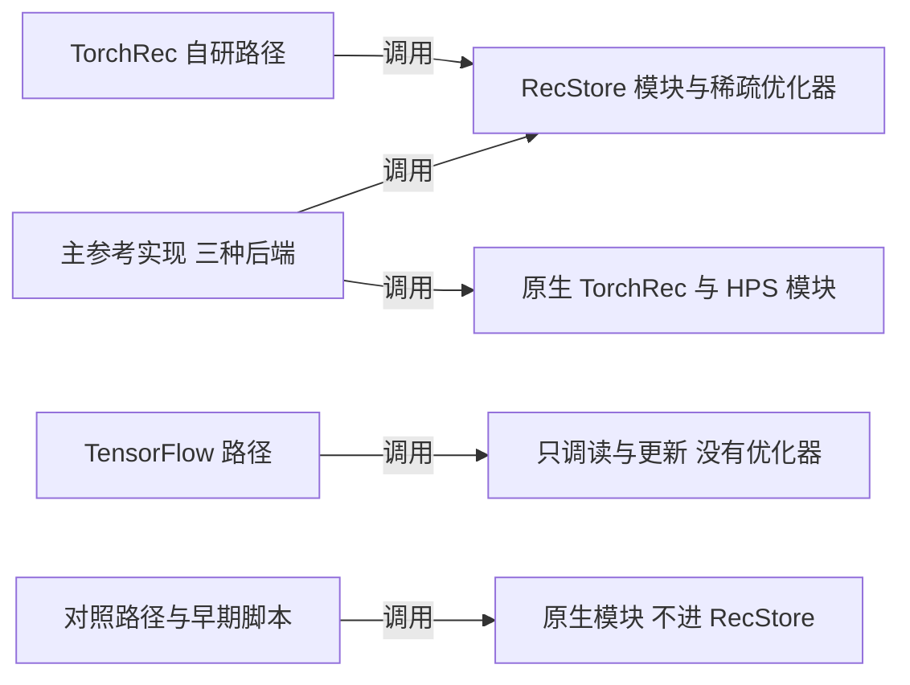

目录里有九个训练入口，但接不接 RecStore 与文件名无关。这一页按「用哪套接口」分成三类。

## 它是什么

想复现一组 DLRM 对照实验，会看到两个几乎同名的脚本（举例）：一个把稀疏表放在 RecStore 上，一个用原生分片规划器把表切在进程内。按名字挑容易挑错，差别在导入的模块。

这几个示例各自用哪套接口？

左边三条都进 RecStore，但方式不同：主参考实现一套代码带三种后端，同时连两处；自研路径只连 RecStore；TensorFlow 那条没有优化器抽象，在 Keras 层自己写梯度。最下面那条导入时就没有 RecStore。

TensorFlow 那条要先编出算子库，缺了运行时就加载失败；其余几套只是 Python 导入，走哪套后端由运行时决定。

## 它为什么存在

对外演示要同一份数据的两种后端对照，也要覆盖 TorchRec 与 TensorFlow 两个生态，所以仓库里既有走 RecStore 的路径，也有故意不接的对照路径——它看起来像没接成功，其实是设计如此。副作用是接入状态不一致：有的入口导入修好了却不被调用，有的注释写着接入了，代码里没有。

## 它和谁接

它们上接各自的训练脚本入口，下接同一套 Python 绑定，共享 embedding 模块与稀疏优化器。九个入口：

| 模型 / 例子 | 入口 | 接 RecStore？ | 备注 |
| --- | --- | --- | --- |
| `rs_demo` | `run_mock_stress.py` → `cli.py` | 是 | 主参考实现；三种 backend（RecStore / TorchRec / HPS Torch）都 `lr=0.01` |
| `torchrec_dlrm` custom | `run_single_day.sh` → `tests/dlrm_main_single_day.py` | 是 | `RecStoreEmbeddingBagCollection` + `SparseSGD`，每步 `zero_grad → forward → backward → validate_config → step → flush` |
| `torchrec_dlrm` 对照 | 同上 `--torchrec` → `tests/dlrm_main_torchrec_single.py` | 否 | 原生 `EmbeddingBagCollection` + `DistributedModelParallel` + `EmbeddingShardingPlanner` |
| `torchrec_dlrm/dlrm_main.py` | 直接运行 | 是（import 已修） | 顶层 `from python.pytorch.torchrec_kv.EmbeddingBag import ...`；`run_single_day.sh` 不调用它，`test_torchrec_dlrm_imports_py` 守护 |
| `criteo_kaggle` 全量 | `run_recstore.sh` / `run_torchrec.sh` | 前者是 | 出 val AUC，默认 2 epoch；`recstore_config.json` 两 shard RDMA |
| `criteo_kaggle` 短步 | `bench_compare.py` | 是 | 调 `tools.benchmarks.e2e.custom.cli`，拓扑只来自自己的 `--clients`/`--ps`，不读 `cluster.sh` |
| `tensorflow_dlrm` | `train.py` + `client.py` | 是 | Keras 层里用 `emb_read`/`emb_update` 手写 `tf.custom_gradient`，没有稀疏优化器抽象 |
| `examples/distributed_dlrm_training.py` | `python examples/...` | 否 | 原生 EBC，注释称接入 RecStore，实际没有；`sys.path` 硬编码作者机器路径 |
| `src/executable/*` | `perf_emb.py` 等 | 部分 | 早期性能脚本，依赖 `pyinstrument`/`debugpy`，不在 CI 与基准驱动里 |

被复用的那套模块本体不含训练循环，所以换后端只换模块来源。TensorFlow 侧从构建产物目录取算子库（默认 `build/lib/lib_recstore_tf_ops.so`）。

## 代码位置

要改代码时再看这里。

- `model_zoo/torchrec_dlrm/run_single_day.sh` — `CUSTOM_SCRIPT` / `TORCHREC_SCRIPT` 的选择。
- `model_zoo/torchrec_dlrm/tests/dlrm_main_single_day.py`、`#dlrm_main_torchrec_single.py` — 两条对照路径。
- `model_zoo/criteo_kaggle/README.md`、`#bench_compare.py`、`#start_rdma_ps.py` — 两套入口与短步驱动。
- `model_zoo/tensorflow_dlrm/recstore_embedding_layer.py`、`#client.py` — TF 绑定。
- `src/python/pytorch/torchrec_kv/EmbeddingBag.py`、`#EmbeddingCollection.py`、`#fused_preload.py` — 被复用的模块本体，不含训练循环；顶层 `recstore.__init__` 用 `__getattr__` 懒加载入口类。

## 交付一句

第 2 块到此为止，读者应当知道"目录里有的脚本"与"真正接进来的脚本"不是一回事。[第 3 块](./test-map)接测试地图，说明这些路径各自被什么测试守住。
