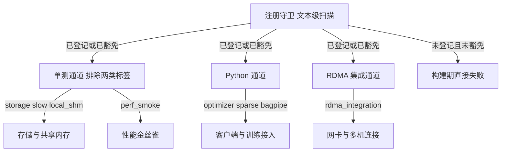
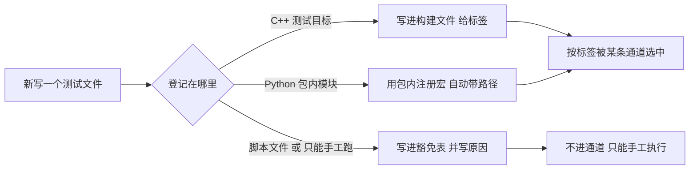

这一页回答：改了一处代码，哪条测试会替你兜住；以及新写的测试为什么会被拦在 CI 外面。它是一张地图，不是教程——先看两层各自由谁驱动，再按标签族找覆盖范围，最后才去表里挑具体文件。

## 它是什么

举例：改掉提交顺序里的一句判断。C++ 那层会在构建产物里挑出对应的测试项，慢的几条要几百秒；Python 那层多数模块已经被登记进同一套驱动，少数几个只能手工跑。判断「有没有人替我兜住」，靠的是标签与登记状态，不是文件名猜。

标签族分别守着哪个子系统？



最上面那个节点是构建期的一次性检查：它只看文件名有没有出现在构建文件或豁免表里，不看测试内容。三条向下的箭头是运行时：单测通道跑得最多，慢的用例要几百秒；Python 通道集中在客户端与训练接入；RDMA 通道没有网卡就直接跳过。下方四个方框是覆盖范围，标签族只是索引，真正的粒度到文件。

## 它为什么存在

[推断] 这套系统的失效方式很少表现为崩溃，更多是"数值还对但顺序错了"或"路径悄悄退化成慢路径"。所以测试按不变量组织：提交幂等、到达顺序、所有权语义、位精确对齐。

另一条理由更朴素：这些测试的前置条件差别很大，有的要 CUDA，有的要 RDMA 网卡，有的要 io_uring 或临时目录，随手跑全量会被硬件卡住，所以必须按标签分通道。

## 它和谁接

向上被 CI 与本地复现脚本调用，向下依赖构建产物与外部条件。跑不起来的测试大多缺前置条件，问题通常不在逻辑。

新写一个测试，登记状态决定它走哪条路？



前两条是自动路径，第三条是例外。登记与豁免的改动都只在下一次构建时生效，之后才进入运行时的通道。豁免要在脚本里写明原因，登记了却仍留在豁免表里的条目会被当成腐烂报出来，所以豁免表不能只加不减。

## 代码位置

要改代码时再看这里。三组分别是注册守卫的规则、本轮新增与变更、以及怎么跑；按改动落点找条目时看[章末附录](./appendix)。

| 入口 | 用途 |
| --- | --- |
| `ctest --test-dir build -LE "python\|rdma_integration"` | 单测 lane（CI 再加 `^perf$`） |
| `ctest --test-dir build -L python` | Python lane |
| `ctest --test-dir build -L rdma_integration` | RDMA 集成 lane，无硬件时 exit 77 |
| `test_registration_consistency` | 新增测试是否注册或豁免的守卫 |

### 子块 3.1：注册守卫

守卫的规则很短：扫描两个测试目录里的文件，文件名必须出现在任意构建文件里，否则必须写进脚本的豁免表。

- 守卫脚本：`src/test/scripts/check_test_registration.py`，扫描 `src/test/test_*.cpp` 与 `src/python/pytorch/recstore/unittest/test_*.py`；匹配是文本级的，文件名必须出现在任意 `CMakeLists.txt` 里。
- 它是 ctest 项 `test_registration_consistency`（`meta;python`），随 python lane 执行，所以**新增测试若既不注册也不豁免，CI 会直接失败**。

存量豁免共 10 条，分三类：

- 5 个 pytest-only 模块：`test_gradient_compression`、`test_sparse_sgd_topk_{backend,distributed,integration}`、`test_topk_strict_prevalidation`。
- 4 个手动 runner：`test_ebc_precision`、`test_ebc_precision_{distributed_runner,multiprocess}`、`test_sparse_sgd_topk_gloo`。
- 1 个 stale：`test_gpu_training_cache`。

脚本同时把"已注册却仍在豁免表"报为 stale，防止豁免表腐烂。

注意守卫的范围不含 `src/test/model_zoo/` 与 `src/test/scripts/`：注册与豁免只对上面两个目录生效。

### 子块 3.2：本轮新增与变更

- `test_cceh` 已注册：`CCEH.cpp` 直接编进测试目标，标签 `storage;slow`、600 s、`RUN_SERIAL`。`test_ssd_extendible_hash.cpp` 已删除（引用已不存在的 API）。
- torchrec 依赖的五个 Python 模块（`test_bagpipe_planned`、`test_fused_prefetch`、`test_shared_fused_namespace`、`test_sparse_optimizer_staging`、`test_step_consistency`）合并为一个 ctest 项 `test_recstore_torchrec_py`，只在 `python -c "import torchrec"` 成功时注册；失败时 CMake 打印跳过原因。
- `add_recstore_unittest` 统一设置 `PYTHONPATH=src/python/pytorch`、cwd 为仓库根；`add_python_unittest` 只设 cwd。注册 Python 包内模块时用前者，注册脚本文件时用后者。
- 新增守护测试：`test_petkv_unsupported`（PetKV 的 checkpoint 显式不支持）、`test_shard_endpoint`（单分片监听地址解析）、`test_torchrec_dlrm_imports_py`（import 路径）、`perf_suite_unit_py`（`test_perf_suite`）。
- 本轮（`6d205e98` 之后）增加的覆盖：`test_report` 不再要求 Debug 构建，`USE_PERF_REPORT=ON` 时即可编译，覆盖 sink 选择与环境变量覆盖；`test_ssd_allocators` / `test_io_backend` 扩到批量窗口、页去重、写失败回滚；`test_ssd_static_layout_value_store` 扩到 CLOCK 交换、异步交换、四种策略选择；Python 侧新增 `test_sharded_update_async_lr` 并注册进 `test_recstore_client_py`；`test_server_ports.py` 覆盖 `--tiered-cache-policy` 的注入与非法值拒绝（该目录不在注册守卫范围内，仍未进 ctest）。
- 本轮（`7c44f83da` 之后）增加的覆盖：`test_ssd_static_layout_value_store` 扩到在线准入（`OnlineAdmission*`：回滚、并发写不被覆盖、staging 余量、合并大请求、范围接口回退）与异步准入（`AsyncAdmission*`：陈旧快照、失败传播、只读请求排空），并断言非法重复批次不写任何一行；`test_ssd_allocators` 开始校验 `GetWriteStats()` 的页写与字节；新增 `test_build_tiered_dram_profile_py`（`add_python_unittest`）。
- 本轮（`f8fde5af4` 之后）增加的覆盖：`test_telemetry`（`add_python_unittest`，标签 `python;telemetry`）覆盖 `telemetry.py` 的候选库排序、`RECSTORE_REPORT_LIBRARY` 覆盖与 `emit` 的缺库降级；`test_e2e_metrics`（`add_recstore_unittest`，同标签）覆盖 `--report-metrics` 发出的 `e2e_step` 行（含终局 loss 补发）；`test_report.cpp` 扩 50 行，覆盖 CSV / JSONL sink 的跨进程行原子。

### 子块 3.3：运行方式与标签

三条通道都用同一套 `ctest` 命令，只换标签；下面是四条常用写法。

```bash
# 单测 lane（CI 用 -LE "python|rdma_integration|^perf$"）
ctest --test-dir build --output-on-failure -LE "python|rdma_integration"
# Python lane
ctest --test-dir build --output-on-failure -L python
# RDMA 集成 lane（无硬件时自动 skip，exit 77）
ctest --test-dir build --output-on-failure -L rdma_integration
# 单点复现
ctest --test-dir build -R test_kvengine --output-on-failure
```

标签族共 22 个，按它们守护的子系统分组：

| 守哪个子系统 | 标签 |
| --- | --- |
| 语言与门禁 | `python`、`meta`、`perf_smoke` |
| 存储与分层 | `storage`、`storage;slow`、`hierkv` |
| 传输与分片 | `local_shm`、`ps_unit`、`ps_integration`、`rdma_integration`、`integration` |
| 训练接入 | `optimizer`、`sparse`、`bagpipe`、`torchrec`、`torchrec_kv`、`rs_demo`、`config` |
| 算子与框架 | `torch_ops`、`ebc`、`hugectr`、`gpu` |

- 资源属性另有一组：`RUN_SERIAL`；`RESOURCE_LOCK`（`local_shm_tests`、`gpu_tests`、`perf_smoke`）；`SKIP_RETURN_CODE 77`。

Python 模块手工运行时需要 `PYTHONPATH=src/python/pytorch`，ctest 项已内置这个环境。

### 按文件查

- `src/test/CMakeLists.txt#add_python_unittest`、`#add_recstore_unittest`、`#add_test` — 注册表。
- `src/test/scripts/check_test_registration.py` — 注册守卫与 `EXEMPT`。
- `src/ps/rdma/CMakeLists.txt#add_petps_owner_test` — 多 shard owner 测试族。
- `src/framework/CMakeLists.txt` — `pytorch_client_test*` 的 env 与 `SKIP_RETURN_CODE 77`。
- `src/python/pytorch/recstore/unittest/` — Python 侧全部模块。

## 交付一句

第 3 块到此为止：读者应当知道哪一层测试是自动的、哪一层要手工跑，以及新增测试为什么会被守卫拦住。[第 4 块](./benchmark-map)接基准地图，把这些测试守不住的性能问题交给三层口径。
