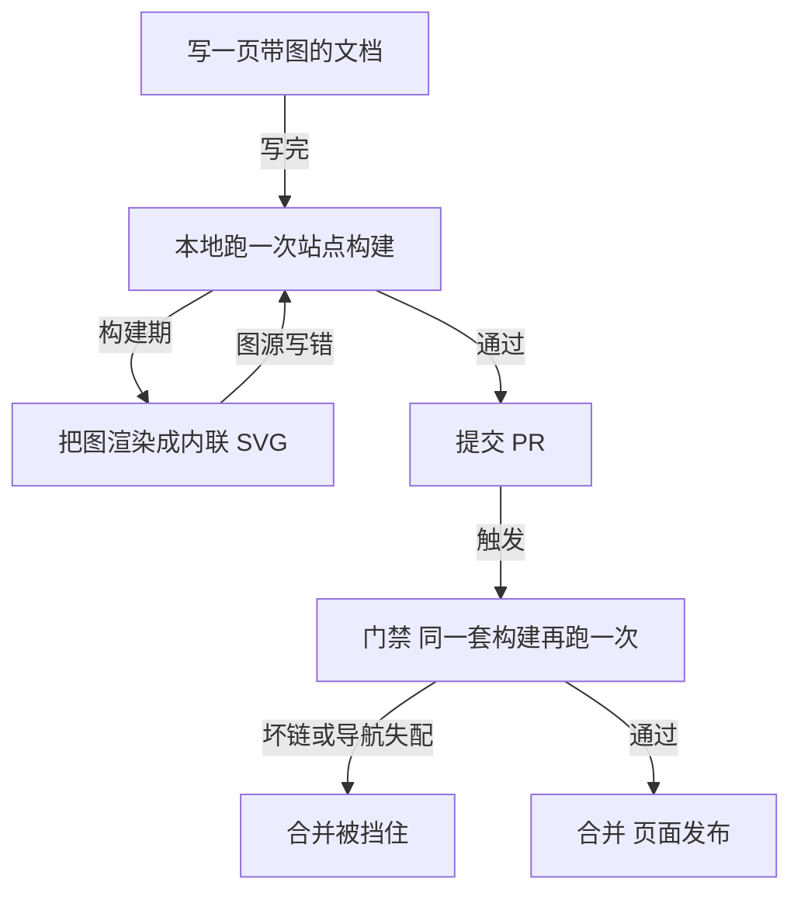

文档站、图、门禁常被当成一件事，其实发生在三个时刻：敲命令、生成页面、PR 被检查。分不清就会出现「本地能构建，合进去却红了」。

## 它是什么

一页讲 RDMA 的资料里有四张图（举例）。作者改完一句结论，本地跑一次严格构建：它顺手把每张图编译成内联 SVG，图源写错就停在这里；提交 PR 后，同一套构建在机器人上再跑，还要管链接指不指得着页面。

本章只保留四条与本篇直接相关的入口。CI 复现、覆盖率、打包、配置定位、环境采集这几套脚本仍在仓库里，本章不展开，位置见下表。

| 工具 | 入口 | 作用 |
| --- | --- | --- |
| 文档站 | `mkdocs.yml` + `docs/requirements.txt`，CI 执行 `mkdocs build --strict` | nav 覆盖 usage / dev / architecture / calc / parameter_server / storage / performance / api；`not_in_nav` 排除 `agent/perf.md`、`calc/interfaces.md`、`dev/performance.md`、`dev/zero_config_run.md` |
| 文档门禁 | `.github/workflows/doc-check.yml` | PR 触及 `README.md`、`docs/**`、`mkdocs.yml` 或部署 workflow 时跑同一套 `mkdocs build --strict`，坏链与失配的 nav 在合并前失败 |
| 格式 | `tools/format/clang_format.sh [--check] [--all\|--staged\|--changed]` + `.githooks/pre-commit` | 只处理 `src/**/*.{cc,cpp,h}`；CI 固定 `clang-format==18.1.3` |
| 注册守卫 | `src/test/scripts/check_test_registration.py`（ctest 项 `test_registration_consistency`） | 新增测试必须注册或写入 `EXEMPT`，见[第 3 块](./test-map) |

同一份文档，三件事各自在什么时候跑？

图上三件事：本地构建、构建期渲染图、PR 门禁。前两件是同一次构建里的先后两步，不是两条命令——图被构建器换成 SVG，页面里因此没有图表运行时。门禁只换了执行者，多出的判据是链接与导航。

这三个判据都不在运行时结算：页面能不能生成、链接指不指得着，在读者打开之前就有答案。上游站由 mkdocs 构建，讲解站用 VitePress 与 pele，图在讲解站的构建期就画成 SVG。

## 它为什么存在

本地与 CI 的差异是排查成本的主要来源：同一份文档，作者机器上能生成，机器人上因为一个失效链接失败。复现脚本与环境采集压缩这个差异；格式与注册守卫把评审意见提前成提交前失败。

代价是四个入口各绑一个时刻。格式检查在提交前，注册守卫在测试运行时，文档门禁在 PR 上；放错时刻，检查就退化成事后追认。

## 它和谁接

向上被开发者和 CI 直接调用，向下操作构建目录、测试驱动与文档站，只改变检查什么时候跑。按落点选命令见[第 5 块](./verification)，被守住的测试见[第 3 块](./test-map)。

## 代码位置

要改代码时再看这里。

- `tools/format/clang_format.sh`、`.githooks/pre-commit`、`.github/workflows/format.yml` — 格式与钩子。
- `tools/ci/reproduce.sh` — CI 复现。
- `tools/coverage/` — 覆盖率采集。
- `tools/packaging/` — 打包。
- `tools/config/` — 配置定位。
- `tools/env/collect.py` — 环境采集。
- `mkdocs.yml`、`.github/workflows/doc-deploy.yml`、`.github/workflows/doc-check.yml`、`docs/performance/methodology.md` — 文档站、PR 门禁与口径来源。
- `src/test/scripts/check_test_registration.py`、`.github/workflows/test.yml` — 注册守卫与 CI lane。

## 交付一句

第 6 块到此为止。6 块走完：接入 → 其它模型 → 测试 → 基准 → 验证路径 → 工具。下面的附录与风险清单按需查阅。
