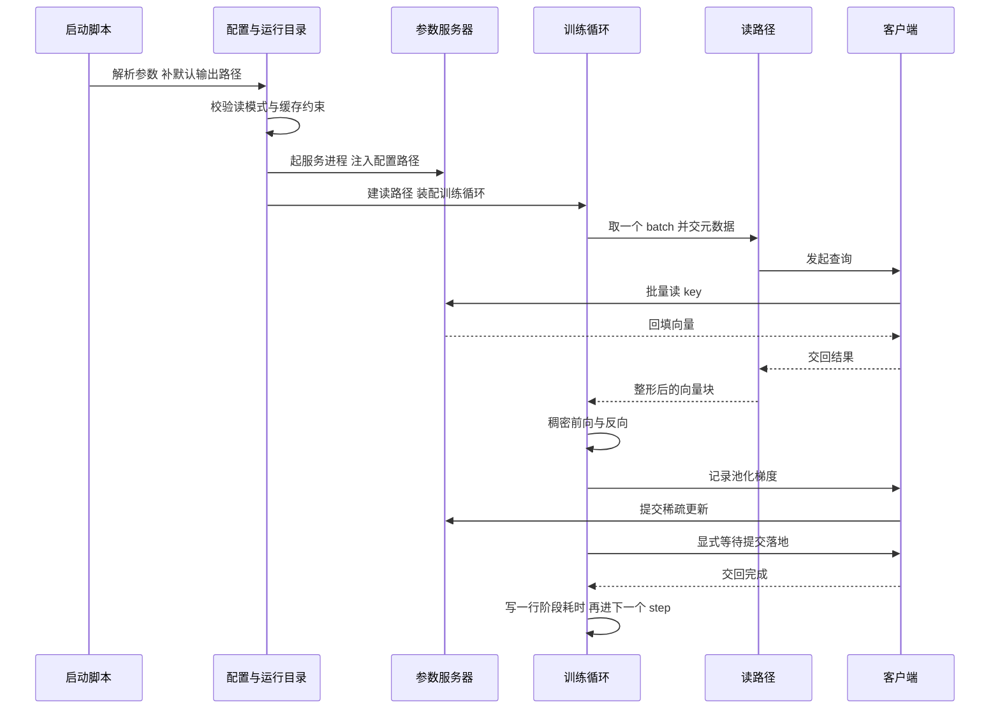
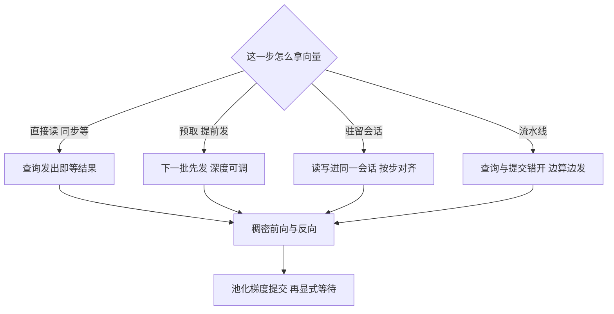

仓库里有一个自带参数服务器的演示训练工程。它不教模型结构，教的是顺序：一次运行里，查询、前向、反向、提交、等待分别排在哪一步。这一页先给一次真实运行的样子，再把这条顺序和四种读法画出来；要改代码时，末尾那张清单才是入口。

## 它是什么

举例：端到端基准的一个 lane 固定跑十二个 step，前两个是预热，不计入平均；演示工程自己的默认值是八十步、预热五步，向量维度一百二十八。每个 step 里要依次做七件事：取 batch、查向量、整形、稠密前向与反向、交稀疏梯度、更新稠密参数、收尾计时。

从启动到每个 step 的收尾，接口分别在哪一步被调？

上半段四条箭头整次运行只走一遍，是启动开销；从取 batch 往下的箭头每个 step 重走一遍，它们的总长就是 CSV 里那一行，也就是这一步的运行时长。真正跨进程的只有两条：批量读 key 和提交稀疏更新。「显式等待」不是新请求，它是回过头等上一次提交被服务端确认。

## 它为什么存在

顺序不能随意调。前向要用向量，所以查询必须排在前向之前；梯度只有反向之后才存在，所以提交只能排在反向之后；提交是异步的，而下一步的读取又要用到刚更新的行，所以中间要有一次显式等待；检查点要求所有提交落地才能拍，于是它排在循环之外。

这套顺序被固化成一条能跑的循环，价值在于新模型不必重新推导这些依赖，照抄即可。仓库里其它模型与例子都是它的变体，差别只在读路径和优化器换成了谁；它自己就是端到端基准的被执行程序。

## 它和谁接

上游是命令行与基准驱动脚本，下游经 Python 绑定落到参数服务器，再落到存储。这一层不实现存储语义，只决定什么时候发什么请求；选哪种读模式就是在这里定的。

同样一个 step，四种读模式把等待挪到了哪里？

分叉只发生在查询这一步，汇合点都是稠密前向。四条分叉都在每个 step 重复发生，没有一条是一次性开销。差别在等不等：直接读在前向之前把网络往返吃掉；预取把往返挪到上一个 step；流水线让提交和下一批查询同时在飞。选哪种不是口味，是硬约束——下面表格里那几列写明谁必须关掉缓存、谁必须关掉预检。

## 代码位置

要改代码时再看这里。四组分别是启动顺序、读模式约束、一个 step 的接入点、检查点入口。

### 子块 1.1：启动链

一次后端运行的分层顺序：

1. `parse_config` 解析 CLI 或 `--run-config-json`，`populate_default_paths` 填默认输出路径；
2. `validate_recstore_config` / `validate_torchrec_config` / `validate_hps_torch_config` 做交叉约束校验（例如 `read_mode=ps_pipeline` 必须 `plugin=none`、无 GPU cache、无 prescan、且开启 embedding fusion）；
3. `make_runtime_dir` 生成 `recstore_config.json`（含 `ps_type`、KV 容量、`value_size_bytes = embedding_dim * 4`、index 类型；`ps_kv_backend=recstore_tiered` 时还写 DRAM 容量倍率与 `value.tiering.cache_policy`），并把路径写进 `RECSTORE_CONFIG`；`--tiered-cache-policy` 接受 `LRU` / `none` / `clock`，默认 `clock`（主放置交换），只有 `none` 才是 cache-off 基线；
4. 需要时 `start_server`（RPC/SHM）或 `start_rdma_server_cluster`（RDMA，额外注入 `RECSTORE_RDMA_*` 环境变量）；
5. `build_runner(...).run(...)`：单进程直接进 `_run_local_worker`，多进程走 `BenchmarkRunner._run_distributed`，用 `torch.distributed.run` 重新拉起 `run_mock_stress.py`，每个 rank 读同一份 `worker_config.json`；
6. rank 把行写入 `rank<N>.csv`，主进程 `_merge_rank_csvs` 合成 `recstore_main.csv`，随后 `cli.py` 调 `analyze_embupdate` 生成 `recstore_embupdate.csv`。

### 子块 1.2：读路径选择

建读路径的那一步决定查询怎么发、梯度怎么回，四种模式各有硬约束。

| `--read-mode` | 实现 | 关键约束 |
| --- | --- | --- |
| `direct` | `DirectReadPath` | 同步查询；`prefetch_depth` 被忽略（runner 会打印提示） |
| `prefetch` | `PrefetchReadPath` | 深度由 `--prefetch-depth` 控制 |
| `bagpipe` | `BagPipeReadPath` + `OptimizationPluginRegistry.create("bagpipe")` | 自动把 `optimization.plugin` 设为 `bagpipe`；`prescan` 需显式开启 |
| `ps_pipeline` | `PSPipeline` 或 `GPUOwnerPipeline` | 必须 fusion、`plugin=none`、无 GPU cache、无 prescan；GPU owner 还需 RDMA + `--dense-cuda-graph` |

- 早期提交：流水线模式可以把提交提前到反向那一刻。打开 `--ps-pipeline-early-submit` 时，`PSPipelineSGD.submit_pooled_grad` 挂在 `embedded_sparse` 的 autograd hook 上；关掉则在 step 内用 `record_pooled_grad(sparse_grad)` 显式记录。

### 子块 1.3：一个 step 的接入点

本地 worker 的循环顺序与对应符号：

| 顺序 | 阶段 | 代码接入点 | 计时列 |
| --- | --- | --- | --- |
| 1 | 取 batch + 元数据 | `prepare_next_batch`、`read_path.on_batch_prepared` / `queue_cpu_metadata` | `batch_prepare_ms`、`input_pack_ms` |
| 2 | embedding 查询 | `read_path.before_lookup` → `read_path.lookup` / `plugin._controller.lookup` / `embedding_module(features)` | `embed_lookup_ms` |
| 3 | 结果整形 | `reshape_torchrec_embeddings_for_dlrm`、`prepare_hybrid_dlrm_input` | `embed_pool_local_ms`、`output_unpack_ms` |
| 4 | dense fwd/bwd | `compute_dense_loss`（或 `dense_graph(...)` 整图） | `dense_fwd_ms`、`backward_ms`、`dense_graph_ms` |
| 5 | 稀疏梯度回写 | `record_pooled_grad` → `sparse_optimizer.step()` → `sparse_optimizer.flush()` → `read_path.after_sparse_update` | `sparse_backward_replay_ms`、`sparse_optimizer_step_ms`、`sparse_optimizer_flush_ms` |
| 6 | dense 优化器 | `dense_optimizer.step()` + `zero_grad(set_to_none=True)` | `dense_optimizer_ms` |
| 7 | 收尾 | `timer.finish()`、`read_path.after_step_sync`、`finalize_recstore_row` | `step_sync_wait_ms`、`step_total_ms` |

三条关键事实可以直接对照源码验证：

- 三种 backend 的学习率都硬编码为 `0.01`：`RecStoreRunner._build_training_modules` 的 dense SGD 与 `SparseSGD`、`TorchRecRunner._run_single_or_dist_worker` 的 dense/sparse SGD、`HpsTorchRunner` 的 dense SGD 都是 `lr=0.01`（HPS 的稀疏更新在 LookupLayer 内部，`sparse_optimizer_ms` 记 0）；`RunConfig` 没有 `--learning-rate` 字段。loss 对齐脚本因此不需要同步 lr。
- 稀疏更新是"提交 + 等待"两段式：`SparseSGD.step` 在通用路径把 update 放进 `_inflight_handles`（local_shm 单表与单机分布式 fast path 则同步写入 `_last_update_payloads`），`flush()` 对 in-flight handle 逐个 `kv_client.wait(handle)` 并计入 `update_flush_wait_ms`。读后写可见性靠 `flush` 与 `read_path` 的提交顺序保证，不靠 step 边界。
- 每个 stage 的 GPU 计时用 `StepTimer.gpu`（CUDA event），host/网络阶段用 `StepTimer.cpu`（wall clock）；`finish()` 只做一次 `torch.cuda.synchronize`，把 straggler 等待单独记为 `step_sync_wait_ms`。

阶段耗时除了落进 CSV，还能直接进观测管道：13 列按 step 各发一行，观测端看到的与 C++ 调用点是同一批 sink，不必等文件落地。

- 发送端：`--report-metrics` 把 `_E2E_STEP_METRICS` 的 13 列以 `e2e_step` 表发进观测 sink，`uid` 形如 `<run_id>|step<N>`，只有 rank 0 发；连续循环的 `loss` 要等末尾读回，届时按 `names=("loss",)` 单独补发。
- 接收端：`recstore.telemetry.emit()` 经 ctypes 调 `libreport.so` 的 `report()`，与 C++ 调用点共用 `remote`/`csv`/`jsonl`/`glog`；库不存在时 `available()` 为 `False`、`emit()` 返回 `False` 而不抛。

### 子块 1.4：checkpoint 的真实入口

真正可恢复的快照在参数服务器那一侧，不在训练脚本里。

- `KVClient.save_checkpoint(path, metadata)` 先 `flush_async_updates()`，再把 metadata 当 JSON 校验（必须含 `identity` 与 `checkpoint_id`），最后调用 ops 的 `save_checkpoint`。
- `KVClient.load_checkpoint` 拒绝存在 pending async op 的客户端，成功后清 GPU cache。
- 训练侧诊断快照是 `runtime/validation.py#export_validation_state`（`--validation-state`），文件里显式标注"diagnostic snapshot, not a resumable training checkpoint"。

文档与代码不一致：命令行那条保存路径当前不可用，检查点只能走客户端接口。

- `model_zoo/rs_demo/runners/recstore_runner.py#_run_local_worker` 的 `--save-checkpoint` 分支执行 `from ..checkpoint import export_checkpoint`，但 `model_zoo/rs_demo/` 下仍不存在 `checkpoint.py`。
- `--checkpoint-all-ranks` 只在 `config.py` 定义，没有消费者。
- 结论：checkpoint 只能走 `KVClient.save_checkpoint`。

### 按文件查

- `model_zoo/rs_demo/cli.py#main`、`#build_runner`、`#make_runtime_dir` — 启动顺序、`RECSTORE_CONFIG` 注入、RDMA 集群起停。
- `model_zoo/rs_demo/runners/base.py#BenchmarkRunner._run_distributed`、`#_merge_rank_csvs` — torchrun 骨架与 rank CSV 合并。
- `model_zoo/rs_demo/runners/recstore_runner.py#RecStoreRunner._build_read_path`、`#_run_local_worker` — 读路径分支与 step 循环。
- `src/python/pytorch/recstore/optimizer.py#SparseSGD.step`、`#flush` — 提交与刷新。
- `src/python/pytorch/recstore/KVClient.py#RecStoreClient.save_checkpoint`、`#load_checkpoint` — 检查点契约。

## 交付一句

第 1 块到此为止：新模型照抄这条循环就能接上，并且知道检查点只走客户端那条路。[第 2 块](./model-examples)接其它模型与例子，清点哪些脚本真的在用这套东西。
