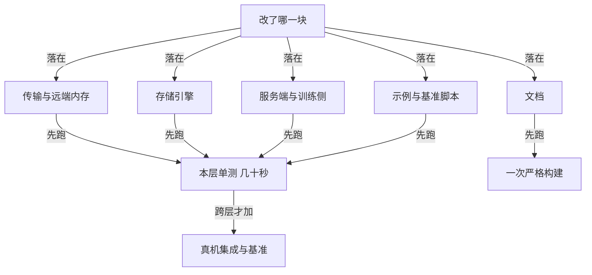

改了一行代码，怎么知道没改坏？这一页把「改了哪里」映射成「跑哪几条」，并说明为什么多数改动只需要几十秒的确认。

## 它是什么

假设有人放宽了稀疏提交头里某个字段的校验（举例）。它不影响整条链路，只影响客户端与服务端对同一份头的约定，所以起点是协议那层几条单测：几十秒，本机跑完。只有同时碰到服务端的接收边界，才要真机集成与基准。

改了哪一块，该跑哪一档？判断只有两步：认出落点属于哪一层，再决定要不要从最小档升到全量档。

五条分支都停在最小档，彼此没有先后，每次只走一条；只有汇到最下面一格才需要真机或整轮训练，文档那条到严格构建就结束。图里几乎全是运行时检查：单测要跑起来才算数；唯一在构建时判死的是文档那一格。

每一层的具体命令：

| 改了什么 | 先跑（最小） | 再跑（全量） |
| --- | --- | --- |
| `src/ps/rdma/*`、`rdma_protocol.h` | `ctest --test-dir build -R 'test_rdma_rc_protocol\|test_raw_verbs_allocator\|test_rdmaps_client_adapter'` | `ctest --test-dir build -L rdma_integration`，再 `run_benchmark_ps.py --transports rdma` |
| `src/storage/**`、`src/memory/**` | `ctest --test-dir build -R 'test_kvengine\|test_index\|test_kvengine_checkpoint\|test_ssd_layout\|test_ssd_allocators\|test_io_backend'` | `run_kvengine_compare.py --engines petkv dram_pet_dram dram_pet_tiered --workloads a b c`；改 tiering 时再跑 `run_tiered_cache_sweep.py` |
| `src/ps/base`、`src/ps/{grpc,brpc}` | `ctest --test-dir build -R 'test_ps_client_factory\|brpc_ps_server_unit_test\|test_ps_server_launcher\|test_shard_endpoint'` | `run_benchmark_ps.py --transports grpc,brpc`；改学习率透传时加 `test_recstore_client_py` |
| `src/base/report/**`、`observability` 配置 | `ctest --test-dir build -R test_report`（需 `USE_PERF_REPORT=ON`） | 用 `RECSTORE_REPORT_SINKS` 起一次真实上报，核对 `csv`/`jsonl` 产物 |
| `src/python/pytorch/recstore/ps_pipeline/**` | `PYTHONPATH=src/python/pytorch python -m unittest recstore.unittest.test_ps_pipeline recstore.unittest.test_ps_pipeline_dependency_split` | `ctest --test-dir build -R 'test_ps_pipeline_py\|test_ps_owner_native_py'`，再跑 loss 对齐两拓扑 |
| `src/python/pytorch/recstore/bagpipe_cache/**` | `PYTHONPATH=src/python/pytorch python -m unittest recstore.unittest.test_bagpipe_cache recstore.unittest.test_bagpipe_planned` | `rs_demo --read-mode bagpipe --optimization-plugin bagpipe --optimization-prescan` 的 e2e lane |
| `src/python/pytorch/recstore/optimizer.py`（含 Top-K） | `python -m pytest src/python/pytorch/recstore/unittest/test_sparse_sgd_topk_integration.py src/python/pytorch/recstore/unittest/test_topk_strict_prevalidation.py`（pytest 风格，ctest 未注册） | `test_sparse_optimizer_config_py` + 分布式 topk case + 稀疏精度对齐 |
| `src/python/pytorch/torchrec_kv/**` | `ctest --test-dir build -R test_torchrec_kv_fused_preload_py` | `python -m unittest recstore.unittest.test_fused_prefetch recstore.unittest.test_embedding_collection` |
| `model_zoo/rs_demo/**` | `ctest --test-dir build -R test_hierkv_rs_demo_py` | `ctest --test-dir build -R 'test_hierkv_rs_demo_py\|test_torchrec_kv_fused_preload_py'`，再按 skill 跑 e2e |
| `tools/benchmarks/**` | `python -m unittest src/test/scripts/test_run_benchmark_ps.py` 等对应自测 | `run_all.py --dry-run`，再真跑；改动 perf 注册表时先跑 `perf_suite_unit_py` |
| `docs/**`、`mkdocs.yml` | `mkdocs build --strict` | 看 doc-deploy workflow 的 strict 构建 |

## 它为什么存在

测试前置条件差别很大：有的要 RDMA 网卡，有的要可写的 SSD，有的要 GPU 与多进程。随手跑全量，最常见的结局是卡在环境上，而不是发现 bug。

分层按依赖切，而不是按目录切。协议单测不碰硬件，所以几十秒；集成组要真起进程、真开连接，慢一个数量级。代价是跨了层却只跑本层时，问题会晚到 CI 才暴露。

## 它和谁接

向上被开发者手工执行，向下调用[第 3 块](./test-map)的测试与[第 4 块](./benchmark-map)的基准。CI 是同一条路径的编排版：lane 只是把同样的命令按硬件分组。本地跑绿的那组不该在 CI 变红——除非它没注册，那件事由[第 6 块](./tooling)负责。

## 代码位置

要改代码时再看这里。

- `.github/workflows/test.yml` — 三条 ctest lane 的 `-L`/`-LE` 与排除规则。
- `tools/ci/reproduce.sh` — 本地复现同一组 lane。
- `src/test/CMakeLists.txt` — 表里引用的测试目标名。

## 交付一句

第 5 块到此为止，读者应当能按落点直接挑命令。[第 6 块](./tooling)接工程工具，补齐 CI 之外的日常入口。
