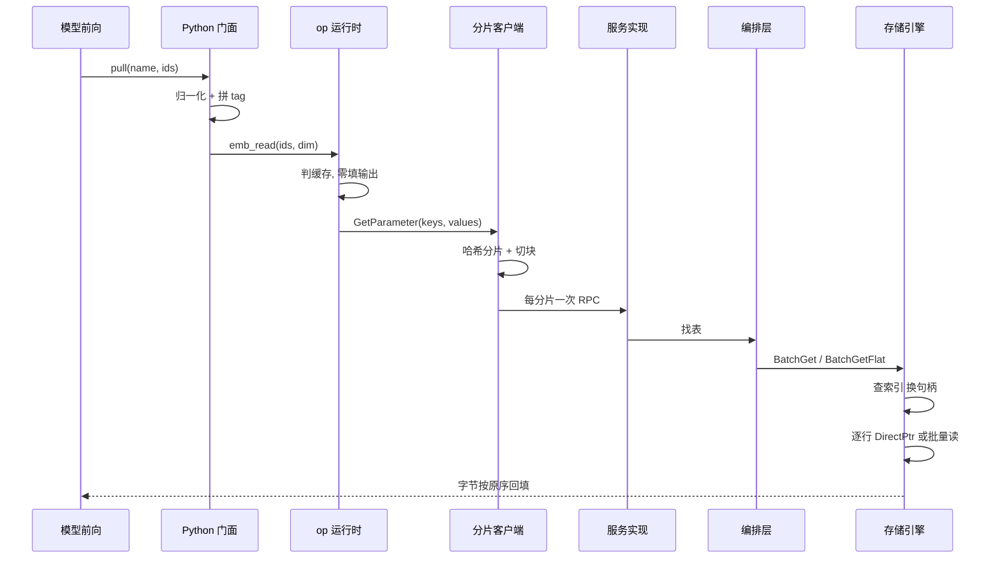

这一页只跟一条读请求。入口是模型的一次前向，出口是存储引擎把字节填进调用方缓冲。中间每个分叉都给出判据：命中哪个条件，代码往哪走。

## 先看全程

读图：虚线之前没有跨进程，虚线的两条箭头才是。Python 门面只做归一化和编码，真正的分流在 op 运行时与服务端编排两层。

## 逐段跟

### 1. 模型前向：确定这一批 id

以自带的 embedding bag 适配模块为例。前向入口先看能不能走融合：本批所有特征的维度一致、且融合开关打开时，把多张表的 id 拼成一个键空间，用表号左移后加上原 id，然后只对主表发一次读。

| 项 | 内容 |
|---|---|
| 入口 | `src/python/pytorch/torchrec_kv/EmbeddingBag.py#RecStoreEmbeddingBagCollection._forward_impl` |
| 判据 | `use_fused`：`enable_fusion` 且各特征维度一致 |
| 出口 | `_pull_fused_rows` → `kv_client.pull(name, ids)`；不融合则逐特征 `pull` |

这一层还可能改道：开了预取就等预取句柄，开了 GPU 缓存就走缓存读，部署成共享内存单表就走直连。这些分支的判据与代价在[第 02 章 · 读路径](../ch02/read-path)。本章只跟默认的同步读。

### 2. Python 门面：把 id 变成引擎认的形状

`KVClient.pull` 做四件事，顺序固定：

1. 查 `_tensor_meta`，确认这张表建过，取 `embedding_dim`。
2. `_normalize_ids`：转 `int64`、转连续、搬到 CPU。
3. `_encode_ids`：如果表带 tag，把 tag 写进 id 的高 8 位；已经带同一个 tag 的 id 原样通过，带了别的 tag 直接报错。
4. 调 `self.ops.emb_read(ids, embedding_dim)`。

| 项 | 内容 |
|---|---|
| 入口 | `src/python/pytorch/recstore/KVClient.py#RecStoreClient.pull` |
| 判据 | `_tensor_meta[name]` 是否存在；tag 为 0 时跳过编码 |
| 出口 | `torch.ops.recstore_ops.emb_read` |

注意 `pull` 把 id 搬到 CPU，所以它不会命中 C++ 侧的 GPU cache；要命中必须用 `pull_with_gpu_cache` 保留 CUDA 张量。

### 3. op 运行时：校验、零填、转给 PS 客户端

`emb_read` 在 C++ 侧的实现只有一行：转给 `CachedReadTorch`。后者先看 GPU 缓存能不能用（要求 key 在 CUDA 上），不能用就直接整批读；能用的分支是「查缓存 → 只读缺失 → 回填 → 散回原位」。

真正落到 PS 的是 op 运行时的读入口：它校验 key 是一维无符号整数、values 是二维浮点且行数匹配，把输出清零，然后把请求交给 PS 客户端。

| 项 | 内容 |
|---|---|
| 入口 | `src/framework/pytorch/op_base.cc#emb_read_torch` |
| 中转 | `src/framework/pytorch/cache/tensor_adapter.cc#CachedReadTorch` |
| 判据 | GPU cache 是否可用（`CanUseGpuCache`，要求 CUDA key） |
| 出口 | `src/framework/op.cc#KVClientOp::EmbRead` → `ps_client_->GetParameter` |

### 4. PS 客户端：分片、切块、出网

PS 客户端是进程级单例，第一次用到时在 op 运行时构造里创建：读全局配置，解析后端类型，交给工厂。gRPC 与 bRPC 都包一层分片客户端，共享内存没有分片层，RDMA 走自己的适配器。

分片客户端收到整批 key 后：

1. 按 `hash_method`（默认 city_hash）把 key 分到各分片，同时记下每个 key 在输出里的原始行号。
2. 每个分片起一个 `std::async`，同一分片内再按 `max_keys_per_request`（默认 500）切块。
3. 每块调单分片客户端的 `GetParameter`。
4. 全部返回后，按行号把各分片结果散回原输出。

| 项 | 内容 |
|---|---|
| 入口 | `src/framework/op.cc#KVClientOp::KVClientOp`（建客户端）、`src/ps/client_factory.cc#CreatePSClient`（选型） |
| 分片 | `src/ps/base/dist_sharded_client.h#DistributedShardedClient::GetParameter` |
| 判据 | `ps_type`：`GRPC` / `BRPC` / `RDMA` / `LOCAL_SHM` |
| 出口 | `GRPCParameterClient::GetParameter` 或 `BRPCParameterClient::GetParameter` |

单分片客户端把 key 列表序列化进请求，发出去后等回复。gRPC 这条用的是异步 stub，凑齐所有分块再一起收。

### 5. 服务端：找表，交给引擎

服务实现的读入口只做三件事：把请求里的 key 还原成数组，交给编排层取数，把结果压进回包。编排层在这一步不查优化器，因为读不需要学习率；它直接调引擎的批量读，再把每行包成一包。

| 项 | 内容 |
|---|---|
| 入口 | `src/ps/grpc/grpc_ps_server.cpp#GRPCParameterServiceImpl::GetParameter` |
| 编排 | `src/ps/base/cache_ps_impl.h#CachePS::GetParameterRun2Completion` |
| 判据 | 无（读路径不经过优化器、不校验学习率） |
| 出口 | `base_kv_->BatchGet(keys, &values, tid)` |

### 6. 引擎：两次翻译

`KVEngineComposite::BatchGet` 先进入读 epoch（没开启读 epoch 时是空操作），再批量查索引。索引交回句柄后，逐行处理：

- 空句柄：这一行以空视图返回；客户端发请求前已把输出清 0，所以最终读到的是 0。
- 有句柄且能直接定址、又没开读 epoch 或在线准入：直接给池内视图，不拷贝。
- 有句柄但拿不到指针，或开了读 epoch / 在线准入：拷进线程缓冲；拿不到指针的行再攒成一批交给值存储批量读。

| 项 | 内容 |
|---|---|
| 入口 | `src/storage/kv_engine/engine_composite.h#KVEngineComposite::BatchGet` |
| 第一次翻译 | `Index::BatchGet`（默认 `DRAM_PET_HASH`） |
| 第二次翻译 | `ValueStore::DirectPtr` / `ValueStore::BatchRead` |
| 判据 | 空句柄；能否直接定址；是否开启读 epoch 或在线准入 |
| 出口 | `std::vector<base::ConstArray<float>>`，每行一个视图或空视图 |

## 传输不同，最后一段不同

上面第 5、6 段以 gRPC 为例。换传输只改「服务端怎么把行交给引擎」，不改前面的训练侧代码：

| 传输 | 服务端入口 | 引擎入口 | 这一段的差别 |
|---|---|---|---|
| gRPC / bRPC | `GetParameterRun2Completion` | `BatchGet` | 每行拷进 `ParameterPack`，再压缩进回包 |
| local_shm | `GetParameterFlat` | `BatchGetFlat` | 输出直接是调用方给的平坦缓冲，少一层逐行包装 |
| RDMA 直读 | `GetParameterDirectFixedRows` | `BatchGetDirectFixedRows` | 引擎直接给每行的地址与长度，由传输层搬走 |

`BatchGetFlat` 与 `BatchGetDirectFixedRows` 的判据都在引擎里：前者要求行宽提示等于行字节、布局是 plain；后者还要求没开在线准入。不满足就返回 false，回到逐行路径。

## 怎么自己跟一遍

1. 在 `KVClient.pull` 下断点，确认 `ids` 的 dtype、device 与高 8 位 tag。
2. 在 `KVClientOp::EmbRead` 下断点，确认 `values` 在调用前已经被清零。
3. 在 `DistributedShardedClient::GetParameter` 下断点，看 `partitioned_keys` 每个分片各多少行。
4. 在 `CachePS::GetParameterRun2Completion` 下断点，确认 `packs` 的行数与顺序。
5. 在 `KVEngineComposite::BatchGet` 下断点，看 `handles` 里有多少个 `kValueHandleNone`。
6. 在 `ValueStore::DirectPtr` 或 `BatchRead` 下断点，确认这一批落在哪一层介质。

下一段接[一次写的代码路径](./write-route)，起点是同一次 forward 的反向。
