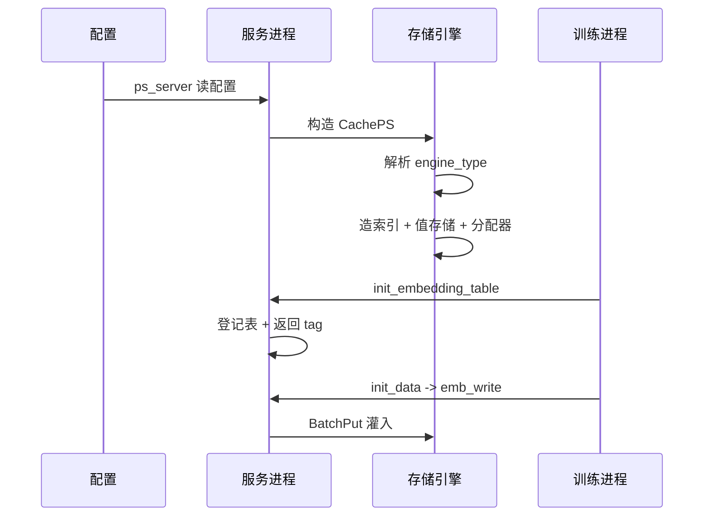

前两页跟的是稳态请求。这一页回答一个更早的问题：存储引擎是什么时候被造出来的、表是什么时候登记的、初始化数据是怎么进去的。这三个时点分得很开，排查「服务起不来」「建表失败」「读到的全是零」时，先确认卡在哪一个。

## 三个时点

读图：引擎构造在服务启动时完成，与客户端无关；建表与灌数据是客户端主动发起的两次调用。所以「服务起来了但读不到表」通常不是引擎问题，而是建表这一步没走到。

## 1. 服务启动：先造引擎，再监听

服务端入口先读配置、按传输类型选择服务实现，然后构造编排层。编排层的构造函数做三件事：

1. 读存储配置，把线程数装进引擎配置。
2. 如果开了在线准入，先检查优化器是不是默认的 SGD；不是就抛异常，服务起不来。
3. 解析引擎名，从工厂造出引擎实例；再按配置造优化器。

引擎自己的构造函数接着做两件事：从 `index.type` / `value.type` 取出两个工厂名，分别造索引与值存储。值存储的构造函数再往下造分配器或 IO 后端。这一串都在监听端口之前完成，所以配置写错会在启动阶段直接报错。

| 项 | 内容 |
|---|---|
| 入口 | `src/ps/ps_server.cpp#main`（选 `GRPC` / `BRPC`） |
| 编排 | `src/ps/grpc/grpc_ps_server.cpp#main` 里的 `std::make_unique<CachePS>` |
| 引擎选择 | `src/storage/kv_engine/engine_selector.h#ResolveEngine` |
| 引擎构造 | `src/storage/kv_engine/engine_composite.h#KVEngineComposite::KVEngineComposite` |
| 组件构造 | `src/storage/index/` 与 `src/storage/value_store/` 各自的工厂注册 |

## 2. 客户端首次调用：懒建连接

训练进程这边，Python 门面是全进程单例，但真正的 C++ 客户端要到第一次读写时才构造：op 运行时的构造函数读全局配置、解析后端、造出客户端。这样模型代码可以在建连接之前先写好。

| 项 | 内容 |
|---|---|
| 入口 | `src/python/pytorch/recstore/KVClient.py#RecStoreClient.__init__` |
| 懒建 | `src/framework/op.cc#KVClientOp::KVClientOp` |
| 工厂 | `src/ps/client_factory.cc#CreatePSClient` |
| 判据 | `ps_type`；RDMA 还要先初始化进程级运行环境 |

## 3. 建表：登记形状，返回 tag

建表接口不写数据，只登记表。客户端把表名、行数、维度与表号发给服务端，服务端编排层检查同名表的形状是否一致，然后调优化器初始化。后者分配一个 tag，并把表配置记下来。

tag 的规则是 `table_id * tensors_per_table + role`，超过 255 抛异常。Python 侧把返回的 tag 记进 `_tensor_meta`，之后所有读写都会把它拼进 key 的高 8 位。

| 项 | 内容 |
|---|---|
| 入口 | `src/python/pytorch/recstore/KVClient.py#RecStoreClient.init_embedding_table` |
| 服务端 | `src/ps/grpc/grpc_ps_server.cpp#GRPCParameterServiceImpl::InitEmbeddingTable` |
| 编排 | `src/ps/base/cache_ps_impl.h#CachePS::InitTable` |
| 判据 | 同名表已存在且形状或 `table_id` 不同 → 返回 -1 |
| 出口 | tag（整数），客户端存进 `_tensor_meta` |

## 4. 灌数据：一次批量写

初始化数据默认把整表填零，再经批量写发出去。服务端收到后按覆盖写处理，一路落到引擎的批量写：每一行都会分配新槽、改索引，旧槽退役。所以初始化一百万行的成本，与正常写入一百万行是同一量级。

如果调用方提供了初始化函数，灌入的是它生成的值；否则就是一个全零张量。只登记表、不写数据时，适合稍后灌数据或从检查点恢复。

| 项 | 内容 |
|---|---|
| 入口 | `src/python/pytorch/recstore/KVClient.py#RecStoreClient.init_data` |
| op | `src/framework/pytorch/op_base.cc#emb_write_torch` |
| 服务端 | `src/ps/base/cache_ps_impl.h#CachePS::PutParameter` |
| 引擎 | `KVEngineComposite::BatchPut`（见[第 05 章 · 写路径](../ch05/write-path)） |

## 5. 检查点与恢复：另一条启动路径

如果表不是从零开始，而是从检查点恢复，顺序换成：服务端先构造空引擎，客户端调 `load_checkpoint`，服务端读文件、重建索引与占用位图。加载要求引擎为空，metadata 与布局标识一致；旧版本文件只允许恢复到 plain 引擎。

| 项 | 内容 |
|---|---|
| 入口 | `src/python/pytorch/recstore/KVClient.py#RecStoreClient.load_checkpoint` |
| 服务端 | `src/ps/base/cache_ps_impl.h#CachePS::LoadCheckpoint` |
| 引擎 | `KVEngineComposite::LoadCheckpoint` |

## 排查顺序

| 现象 | 先看哪一步 |
|---|---|
| 服务进程起不来 | 配置里的 `engine_type`、`index.type`、`value.type` 与必填字段 |
| 服务起来了，读写报「表未初始化」 | `init_embedding_table` 是否成功、tag 是否记进 `_tensor_meta` |
| 读到的全是零 | `init_data` 是否真的写了、`initialize_values` 是否为 false |
| 写入报学习率不匹配 | 客户端 lr 与服务端优化器 lr 是否一致 |
| 检查点加载失败 | 引擎是否为空、metadata 与布局标识是否一致 |

下一段接[定位手册](./locator)，把「已知现象」直接映射到文件与函数。
