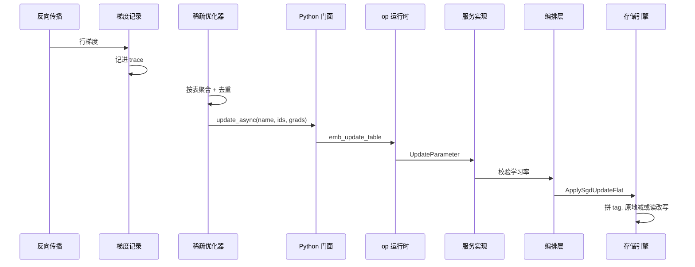

这一页跟一次稀疏更新。入口是反向传播留下的梯度，出口是存储引擎里被改写的一行或一个新槽。和读路径最大的不同是：写有两条完全不同的落地方式，能在原地改就不换槽。

## 先看全程



读图：反向传播不直接写存储，它只把「哪一行、梯度多少」记下来；真正提交发生在优化器的 `step` 与 `flush`。这也是为什么一步训练里写请求的数量与 batch 里出现的 key 数无关，而与去重后的 key 数有关。

## 逐段跟

### 1. 反向传播：先把梯度记下来

前向拿到的 embedding 张量注册了一个 hook。反向时，hook 按行把梯度与对应的 id 追加进模块的 `_trace`；融合路径下 id 是拼好的 fused id，所以后面只需要对 master 表发一次更新。这一步不发生任何网络或存储访问。

| 项 | 内容 |
|---|---|
| 入口 | `src/python/pytorch/torchrec_kv/EmbeddingBag.py#RecStoreEmbeddingBagCollection._append_trace`（hook 在 `_forward_impl` 里注册） |
| 判据 | 这一行梯度是否非空；融合与非融合走不同的 id |
| 出口 | `module._trace`，每项是 `(id, grad)` 或带表名的字典 |

### 2. 稀疏优化器：聚合、去重、提交

`SparseSGD.step` 遍历参数组，对每个带 trace 的模块调聚合函数。聚合做三件事：

1. 把这一步所有 trace 按表名分组。
2. 对同一张表的 id 做 `torch.unique`，再用 `index_add_` 把重复 id 的梯度加起来。
3. 调 `kv_client.update_async(name, ids, grads, learning_rate=lr)`，把返回的 handle 存进 `_inflight_handles`。

刷新时再逐个等句柄。注意这里的「异步」只对 RDMA 成立；其它后端只是把请求暂存在 Python 侧，等到等待时才真正提交，所以它并不会让网络传输提前。

| 项 | 内容 |
|---|---|
| 入口 | `src/python/pytorch/recstore/optimizer.py#SparseSGD.step` |
| 聚合 | `#_process_generic_module_with_trace` |
| 判据 | 模块类型：`DistEmbedding` 走本地权重更新，带 `_trace` 的走后端更新 |
| 出口 | `KVClient.update_async` → handle；`flush` → `KVClient.wait` |

### 3. Python 门面：编码 id，等到时提交

提交接口归一化 id（整型、CPU、连续、拼标签）与梯度（浮点、二维、连续），然后按后端决定怎么暂存：RDMA 直接调 C++ 的异步更新；其它后端把表名、id、梯度与学习率存进待提交表。等待时走同步更新，落到 op 运行时。

| 项 | 内容 |
|---|---|
| 入口 | `src/python/pytorch/recstore/KVClient.py#RecStoreClient.update_async` |
| 判据 | `current_ps_backend() == "rdma"` 且 `emb_update_async` 存在 |
| 出口 | `ops.emb_update_table(name, ids, grads, lr)` |

### 4. op 运行时：校验形状，转给 PS 客户端

op 运行时的写入口把张量转成内部视图，再交给更新函数。后者校验 key 与梯度的行数、维度，然后把表名、key、梯度与学习率交给 PS 客户端。这一层不做聚合，也不认识表结构。

| 项 | 内容 |
|---|---|
| 入口 | `src/framework/pytorch/op_base.cc#emb_update_table_torch` |
| 中转 | `src/framework/op.cc#KVClientOp::EmbUpdateWithLearningRate` |
| 判据 | key 一维、grads 行数与 key 数一致、维度为正 |
| 出口 | `BasePSClient::UpdateParameter` |

### 5. 服务端：校验学习率，交给优化器

服务实现的写入口把请求里的 key 与梯度还原成读取器，交给编排层。编排层先做一次学习率校验：客户端报的学习率必须与服务端优化器的一致，否则直接失败，不会静默忽略。校验通过后调优化器。

| 项 | 内容 |
|---|---|
| 入口 | `src/ps/grpc/grpc_ps_server.cpp#GRPCParameterServiceImpl::UpdateParameter` |
| 编排 | `src/ps/base/cache_ps_impl.h#CachePS::UpdateParameter` |
| 判据 | `CheckLearningRate`：客户端 lr 为 0 时跳过；不为 0 时必须匹配服务端 |
| 出口 | `Optimizer::Update` |

### 6. 优化器：拼 tag，落到引擎

以默认 SGD 为例，优化器的平铺更新把 key、梯度与学习率交给张量适配层，后者转手调引擎的平铺更新。到引擎这一层，标签被拼进 key 的高 8 位：

```text
tagged = (tag << 56) | (key & 0x00FF_FFFF_FFFF_FFFF)
```

之后引擎先整批试探「能不能拿到池内原位指针」：

- 能：直接在池内按列减梯度，不分配、不换槽。
- 不能：走混合路径，按 key 去重，内存行原地改、盘上行读出改完写回、缺失行补初值。

| 项 | 内容 |
|---|---|
| 入口 | `src/optimizer/optimizer.cpp#SGD::UpdateFlat` |
| 中转 | `src/optimizer/sparse_tensor.cpp#SparseTensor::ApplySgdUpdateFlat` |
| 判据 | `BatchGetDirectFixedRows` 是否整批成功；失败即走 `ApplySgdMixedRows` |
| 出口 | `src/storage/kv_engine/engine_composite.h#KVEngineComposite::ApplySgdUpdateFlat` |

### 7. 存储引擎：原地改或换槽

原地路径只碰值存储这一层：命中的行按列减 `lr * grad`，句柄不变。换槽路径则回到上一页第 6 块的覆盖写顺序：分配新槽、写入字节、索引改指、旧句柄退役。

删除是第三种：在独占锁下摘索引、退役，再从每线程的检查点列表里删掉。它不经过优化器。

## 怎么自己跟一遍

1. 在 `RecStoreEmbeddingBagCollection._append_trace` 下断点，确认一次反向进来多少行、id 有没有 fused 前缀。
2. 在 `SparseSGD.step` 下断点，看 `unique_ids` 比 `all_ids` 少了多少——这就是去重的收益。
3. 在 `KVClient.update_async` 下断点，确认后端是 rdma 还是 staged。
4. 在 `CachePS::UpdateParameter` 下断点，确认 `CheckLearningRate` 没有把请求打回。
5. 在 `KVEngineComposite::ApplySgdUpdateFlat` 下断点，看 `BatchGetDirectFixedRows` 的返回值：true 走原地，false 走混合。
6. 在 `ValueStore::Retire` 下断点，确认旧槽什么时候真正归还。

## 和读路径共用的东西

两条路在三个地方汇合：同一个 `KVClient` 单例、同一套 tag 编码、同一个引擎实例。所以改读路径的编码逻辑时，写路径也会受影响；反过来，改 tag 的位宽必须同时改 Python 与 C++ 两侧。

下一段接[启动与建表](./startup)，看这些单例和引擎是什么时候创建出来的。
